<details>
<summary>📖 Оглавление</summary>

- [Модуль 1: Введение в системное администрирование](#модуль-1-введение-в-системное-администрирование)
- [Модуль 2: Базовые команды Linux](#модуль-2-базовые-команды-linux)
- [Модуль 3: Файлы и каталоги](#модуль-3-файлы-и-каталоги)
- [Итоги](#итоги)

</details>

<br>

## Модуль 1: Введение в системное администрирование

### Тест «Роль системного администратора Linux»

**Результат теста:** 2 из 3 (тест пройден).

**Вопрос 1. Что из перечисленного относится к философии свободного ПО?**
Правильный ответ: возможность модификации программы под свои задачи без нарушения авторских прав.

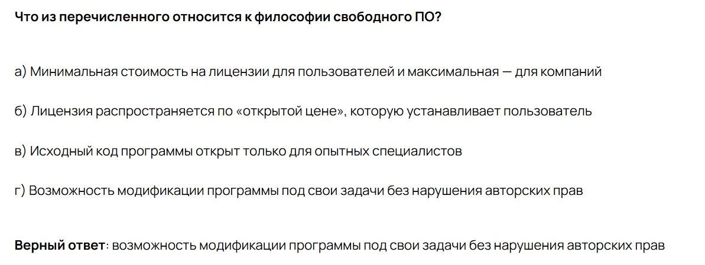

**Вопрос 2. Какой инструмент можно использовать для мониторинга сервисов?**
Правильный ответ: Zabbix. 

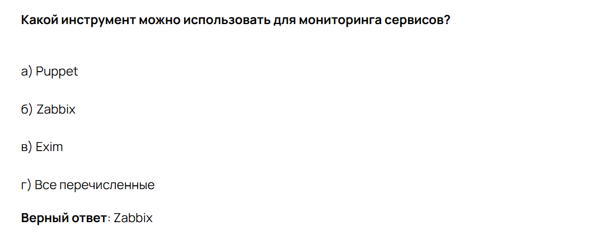

**Вопрос 3. Какая из задач относится к ключевым обязанностям системного администратора?**
Правильный ответ: мониторинг состояния серверов.

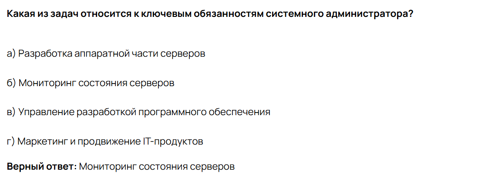

---

## Модуль 2: Базовые команды Linux

### Задания по теме «Вводный урок»

**Задание №1. Установка утилиты htop**
Установили htop из репозитория EPEL через менеджер пакетов dnf.
```bash
sudo dnf install -y epel-release
sudo dnf install -y htop
htop --version
```

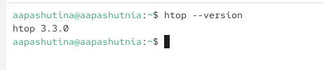

**Задание №2. Запуск htop и сортировка по использованию памяти**
Запустили htop и нажали F6 для выбора сортировки PERCENT_MEM.
```bash
htop
```

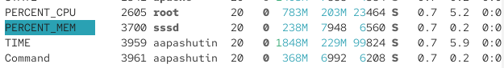

**Задание №3. Свободное место на диске**
Использовали утилиту df с ключом -h.
```bash
df -h
```

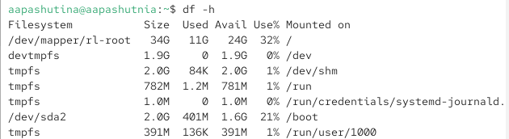

**Задание №4. Подкаталоги в /var, занимающие больше всего места**
Использовали du с ключами -s и -h.
```bash
du -sh /var/*
```

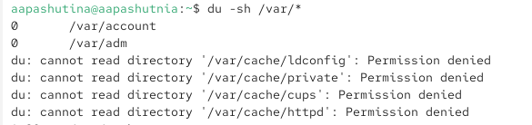

### Тест «Вводный урок»

**Вопрос 1. Как называется самая популярная оболочка?**
Правильный ответ: Bash.

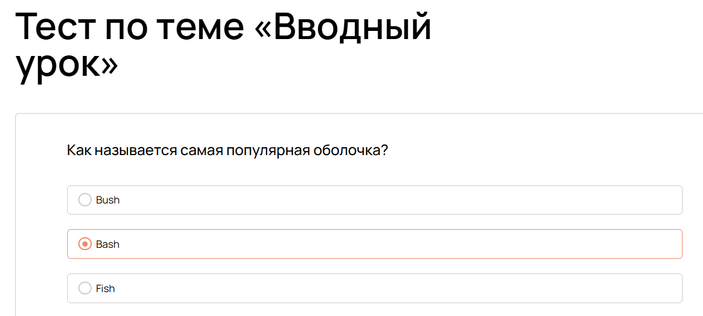

**Вопрос 2. Для чего пользователю иногда требуются повышенные привилегии?**
Правильный ответ: для выполнения административной задачи.

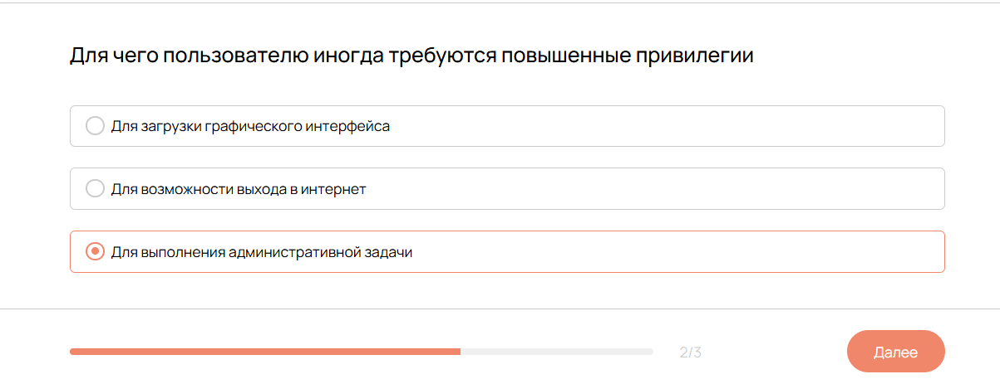

**Вопрос 3. Какая команда выводит наиболее полную справочную информацию?**
Правильный ответ: man.

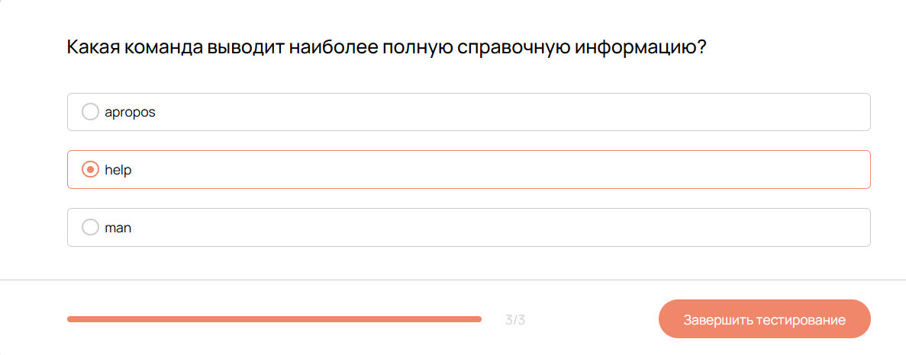

### Задания по теме «Роль командной строки в серверной среде»

**Задание №1. Последние сообщения ядра из системного журнала**
```bash
journalctl -k
```

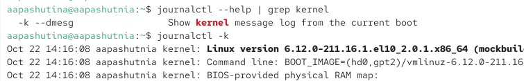

**Задание №2. Проверка состояния SSH**
```bash
systemctl status sshd
```

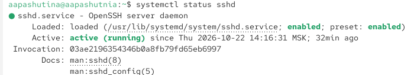

**Задание №3. Список всех активных служб**
```bash
systemctl list-units --type=service --state=active
```

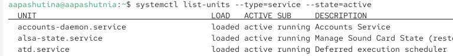

### Тест «Роль командной строки в серверной среде»

**Вопрос 1. Какое главное преимущество отсутствия графического интерфейса на сервере?**
Правильный ответ: экономия ресурсов и повышение стабильности.

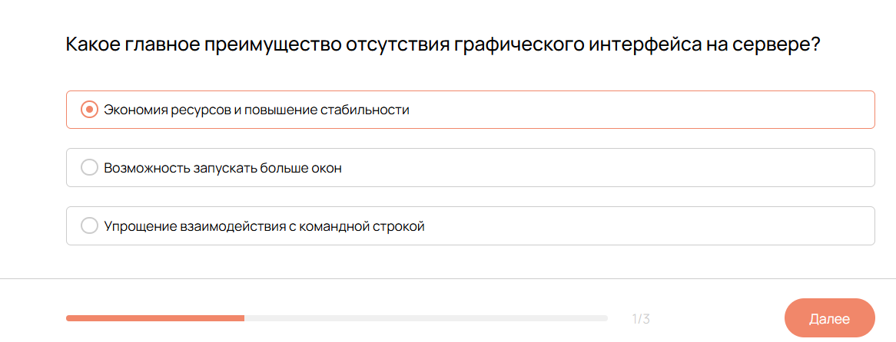

**Вопрос 2. Почему SSH так популярен в администрировании?**
Правильный ответ: даёт безопасный канал для удалённой работы.

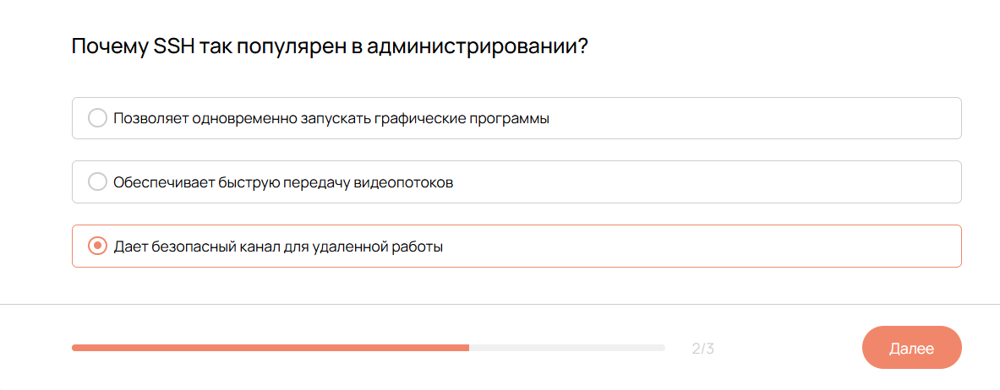

**Вопрос 3. Что отличает терминал от оболочки?**
Правильный ответ: терминал — место ввода/вывода, оболочка — программа-интерпретатор.

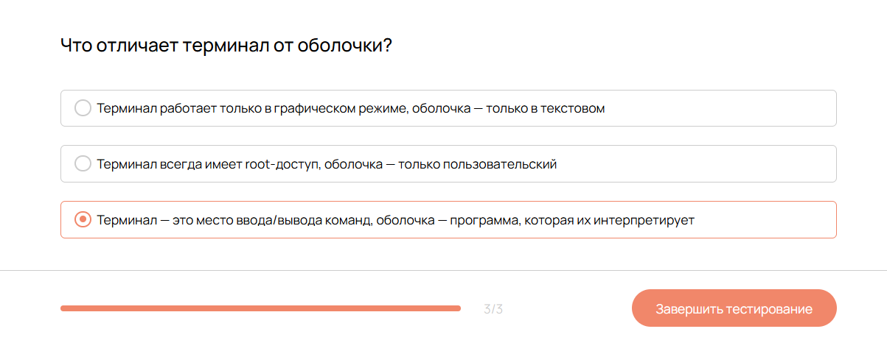

### Задания по теме «Файловая структура и ключевые каталоги»

**Задание №1. Поиск конфигурационного файла сервиса SSH**
```bash
ls /etc/*ssh*
```

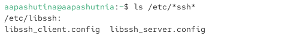

**Задание №2. Просмотр конфигурации SSH в nano**
```bash
nano /etc/ssh/ssh_config
```


**Задание №3. Список журналов в системе**
```bash
ls /var/log
```

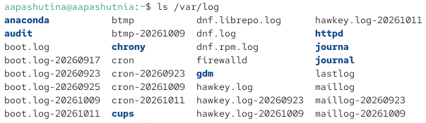

**Задание №4. Последние 20 записей в системном журнале**
```bash
journalctl -n 20
```

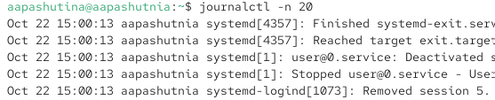

**Задание №5. Проверка «сторонних» приложений**
```bash
ls /opt
```

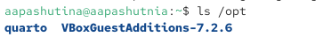

**Задание №6. Действия для перенастройки Nginx**
```bash
cd /etc/nginx
ls -l
sudo cp nginx.conf nginx.conf.backup
sudo nano nginx.conf
sudo systemctl reload nginx
```


### Тест «Файловая структура и ключевые каталоги»

**Вопрос 1. В какой каталог обычно помещаются конфигурационные файлы служб в Linux?**
Правильный ответ: /etc.

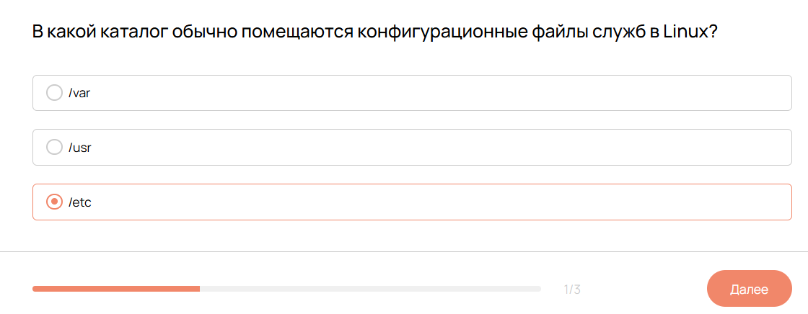

**Вопрос 2. Где чаще всего хранятся логи системных сервисов и приложений?**
Правильный ответ: /var/log.

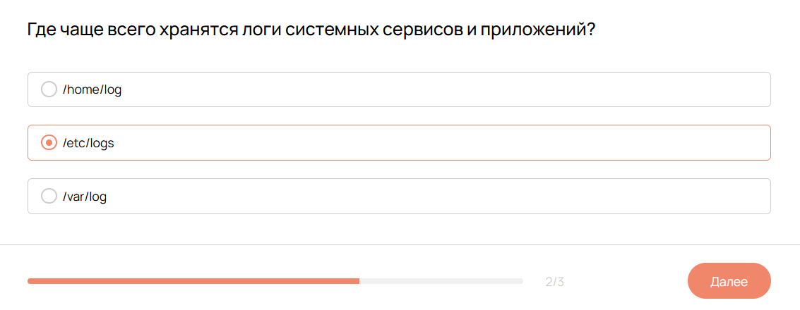

**Вопрос 3. Какую роль выполняет /opt в структуре файловой системы?**
Правильный ответ: дополнительное ПО, которое не входит в стандартные репозитории.

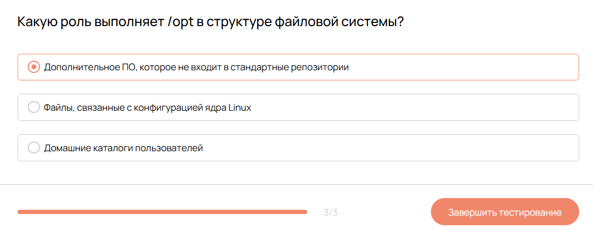

### Задания по теме «Принцип „Всё есть файл“»

**Задание №1. Информация о процессоре**
```bash
cat /proc/cpuinfo | head -n 10
```

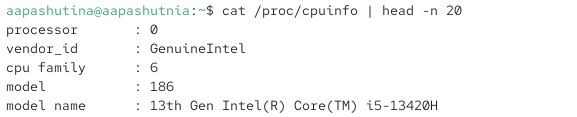

**Задание №2. Данные об использовании памяти**
```bash
cat /proc/meminfo
```

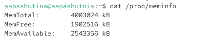

**Задание №3. Список файлов в /dev**
```bash
ls -l /dev
```

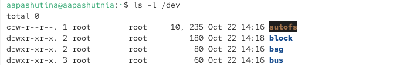

### Тест «Принцип „Всё есть файл“»

**Вопрос 1. Для чего служит каталог /dev?**
Правильный ответ: для представления устройств в виде файлов.

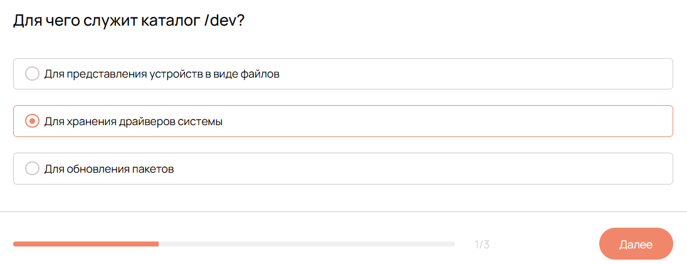

**Вопрос 2. Что отражает виртуальная файловая система /proc?**
Правильный ответ: состояние оперативной памяти и процессов «на лету».

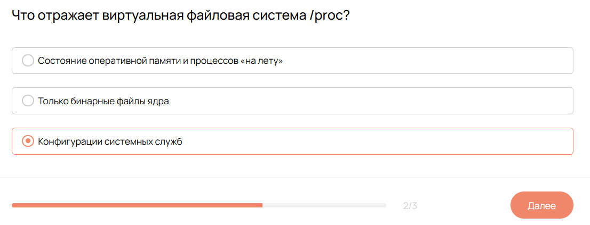

**Вопрос 3. Какая команда позволяет просматривать данные из каталогов /proc или /dev?**
Правильный ответ: cat.

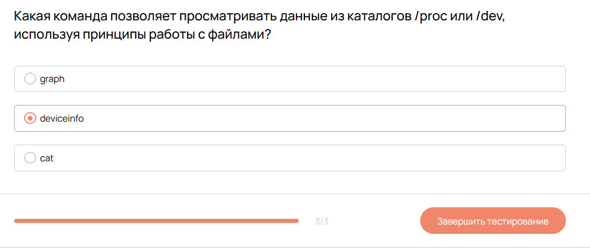

### Задания по теме «Работа с базовыми командами в реальных условиях»

**Задание №1. Узнать текущий каталог**
```bash
pwd
```


**Задание №2. Перейти в домашний каталог и получить список всех файлов**
```bash
cd ~
ls -a
```

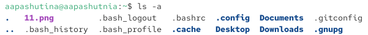

**Задание №3. Последние 10 записей в системном журнале, связанных с systemd**
```bash
cat /var/log/syslog | grep systemd | tail -n 10
```


### Тест «Работа с базовыми командами в реальных условиях»

**Вопрос 1. Какая команда выводит путь к текущей директории?**
Правильный ответ: pwd.

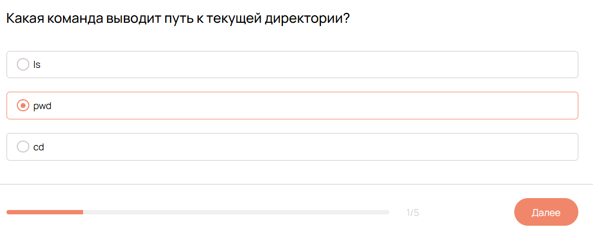

**Вопрос 2. Как показать скрытые файлы и каталоги?**
Правильный ответ: ls -a.

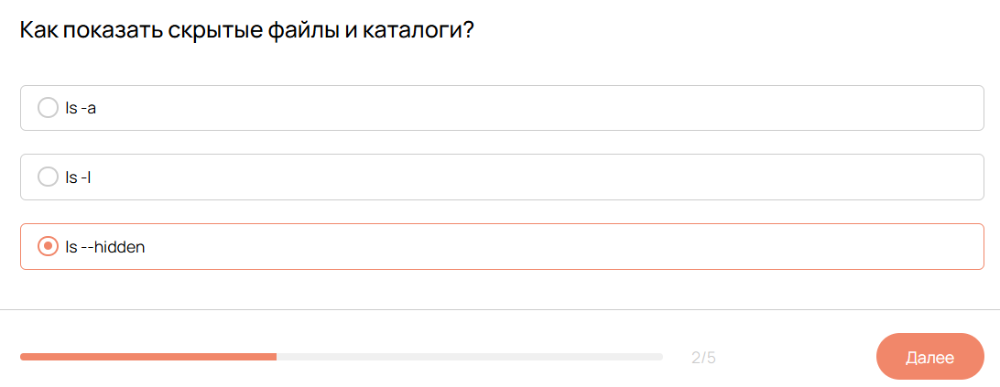

**Вопрос 3. Как перейти в каталог /etc/apache2, если вы уже в /etc?**
Правильный ответ: cd apache2.

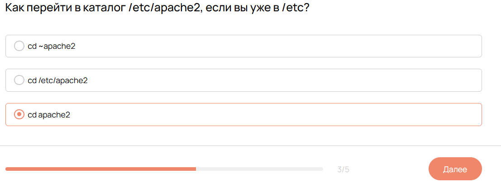

**Вопрос 4. Что означает ~ при вводе команды cd ~?**
Правильный ответ: домашнюю директорию текущего пользователя.

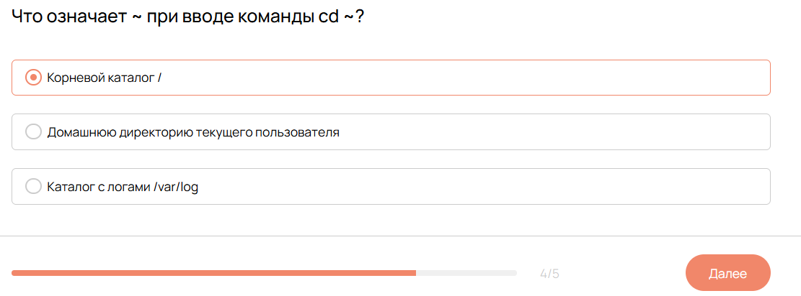

**Вопрос 5. Для чего используется команда ls -l | grep ssh?**
Правильный ответ: для фильтрации строк с упоминанием ssh.

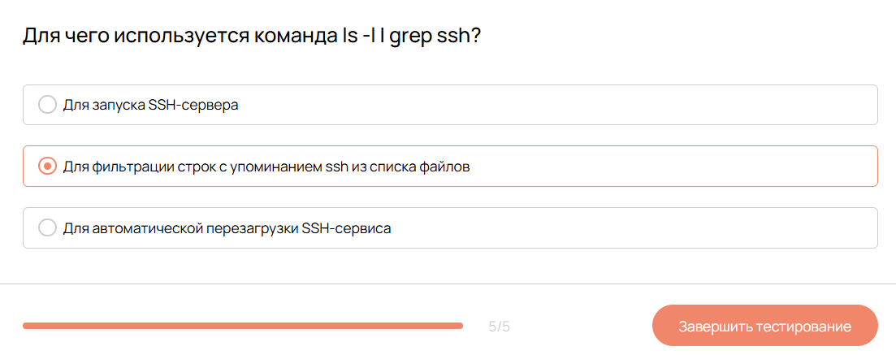

---

## Модуль 3: Файлы и каталоги

### Задания по теме «Базовые команды для управления файлами и каталогами»

**Задание №1. Создание каталога project с подкаталогами**
```bash
mkdir -p ~/project/{logs,data,backup}
```


**Задание №2. Создание файлов error.log и info.txt**
```bash
touch ~/project/logs/error.log ~/project/data/info.txt
ls ~/project/logs ~/project/data
```

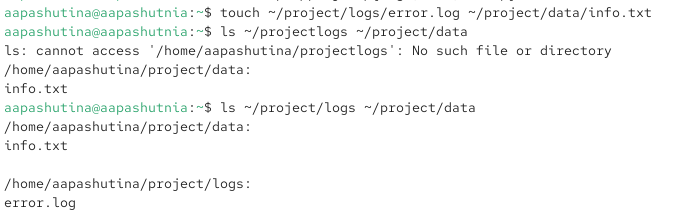

**Задание №3. Копирование файла info.txt в backup**
```bash
cp ~/project/data/info.txt ~/project/backup/
```


**Задание №4. Перемещение файла error.log в data**
```bash
mv ~/project/logs/error.log ~/project/data/
```


**Задание №5. Удаление каталога project**
```bash
rm -r ~/project
```


### Задания по теме «Работа с архивами и передача данных между серверами»

**Задание №1. Создание архива archive_test.tar.gz**
```bash
mkdir ~/archive_test
touch ~/archive_test/file{1..3}.txt
tar -czf archive_test.tar.gz -C ~/ archive_test
```

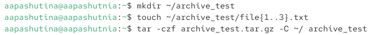

**Задание №2. Извлечение архива в директорию ~/extracted**
```bash
mkdir ~/extracted
tar -xzf archive_test.tar.gz -C ~/extracted
```

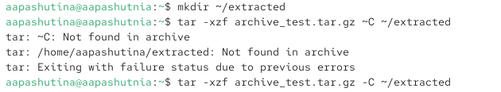

**Задание №3. Передача архива на удалённый сервер**
```bash
scp archive_test.tar.gz user@192.168.1.10:/backups
```

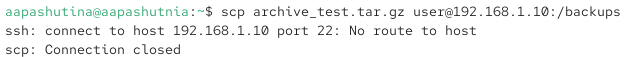

### Тест «Работа с архивами и передача данных между серверами»

**Вопрос 1. Какая команда создаёт сжатый архив из папки?**
Правильный ответ: tar -czf.

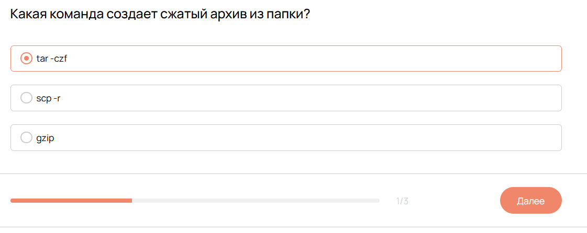

**Вопрос 2. Как извлечь архив?**
Правильный ответ: tar -xzf.

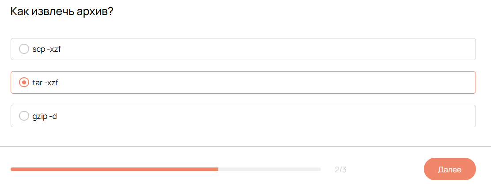

**Вопрос 3. Как скопировать папку с файлами на сервер?**
Правильный ответ: scp -r folder user@server:/backup.

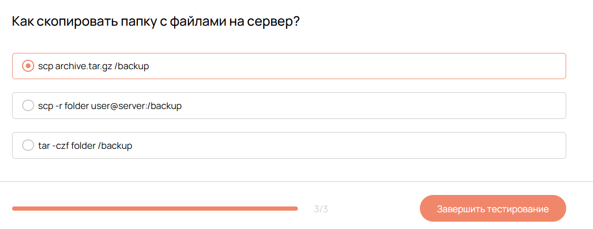

### Задания по теме «Основы автоматизации с помощью Bash-скриптов»

**Задание №1. Создание скрипта clean_logs.sh**
```bash
mkdir -p ~/bin
touch ~/bin/clean_logs.sh
nano ~/bin/clean_logs.sh
```


**Задание №2. Сделать скрипт исполняемым и запустить**
```bash
chmod +x ~/bin/clean_logs.sh
./bin/clean_logs.sh
```


**Задание №3. Автоматизация запуска через cron**
```bash
crontab -e
```
Добавлена строка: `30 3 1 * * ./bin/clean_logs.sh`


### Тест «Основы автоматизации с помощью Bash-скриптов»

**Вопрос 1. Как сделать файл исполняемым?**
Правильный ответ: chmod +x.

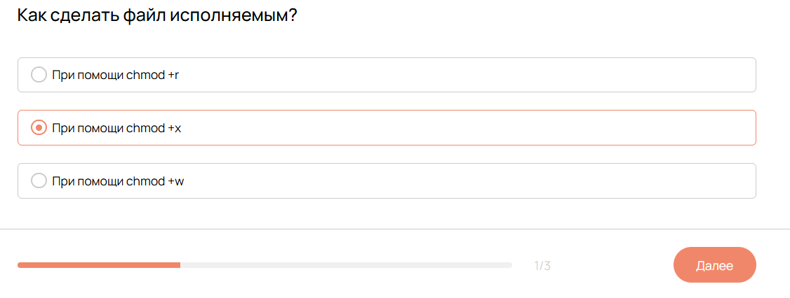

**Вопрос 2. Как добавить комментарий в скрипт?**
Правильный ответ: #.

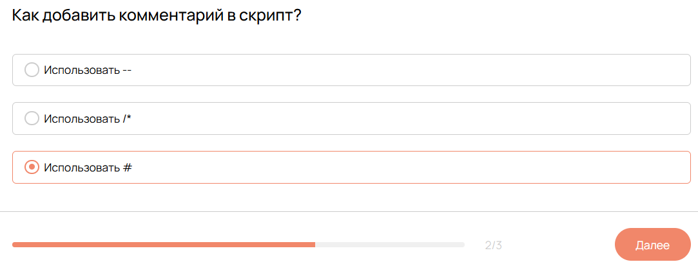

**Вопрос 3. Что делает команда find /var/log -type f -mtime +7 -exec rm -f {}?**
Правильный ответ: находит и удаляет файлы старше 7 дней.

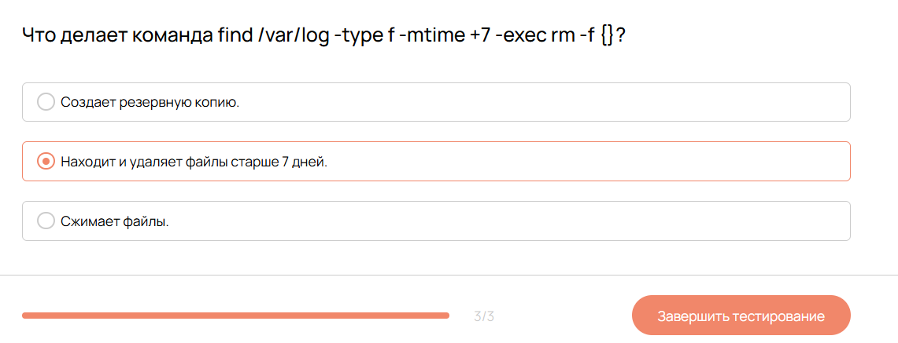

---

## Итоги

В ходе прохождения Части 1 внешнего курса «Системный администратор Linux с нуля» были освоены:

- базовые команды Linux (`pwd`, `ls`, `cd`, `cat`, `touch`, `mkdir`, `cp`, `mv`, `rm`);
- работа с файловой структурой (`/etc`, `/var`, `/dev`, `/proc`, `/opt`);
- управление процессами и службами (`htop`, `systemctl`, `journalctl`);
- работа с архивами (`tar`, `gzip`) и передача данных (`scp`);
- основы автоматизации с помощью Bash-скриптов и cron.

Все тесты и интерактивные задания Части 1 пройдены. Цель работы достигнута.
