

📖 Оглавление

- [Модуль 4: Получение справки. Работа с текстовыми файлами и логами](#модуль-4-получение-справки-работа-с-текстовыми-файлами-и-логами)
- [Модуль 5: Управление пользователями и группами](#модуль-5-управление-пользователями-и-группами)
- [Модуль 6: Управление доступом](#модуль-6-управление-доступом)
- [Модуль 7: Управление процессами](#модуль-7-управление-процессами)
- [Итоги](#итоги)

 

## Модуль 4: Получение справки. Работа с текстовыми файлами и логами

### Задания по теме «Поиск справочной информации в Linux»

**Задание №1. Использование man для команды grep**

man grep

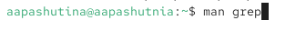

**Задание №2. Поиск документации о systemctl с помощью info**

info systemctl

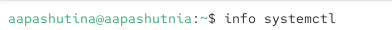

**Задание №3. Открытие локальной документации о info**

ls /usr/share/doc/info

### Тест по теме «Поиск справочной информации в Linux»

**Вопрос 1. Какая команда поможет узнать, как работает утилита grep?**
Правильный ответ: man grep.

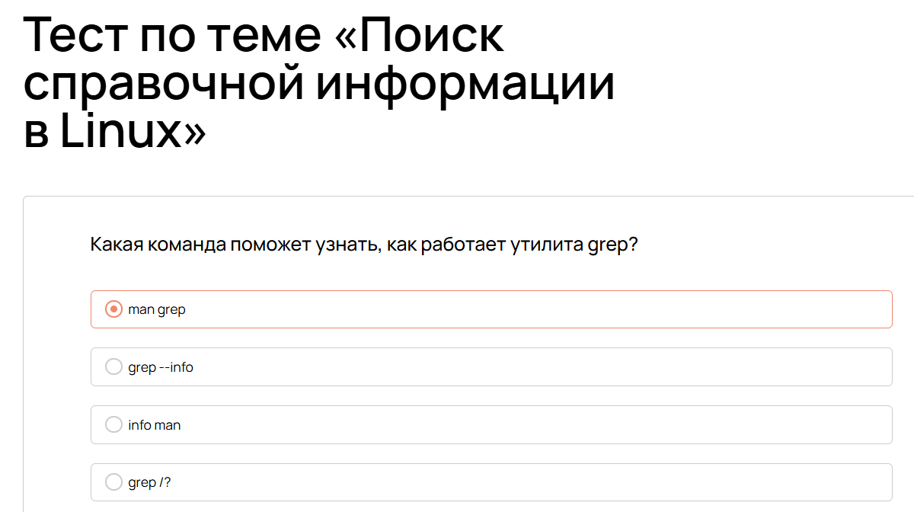

**Вопрос 2. Что делает команда info?**
Правильный ответ: открывает справку в формате info для заданной команды.

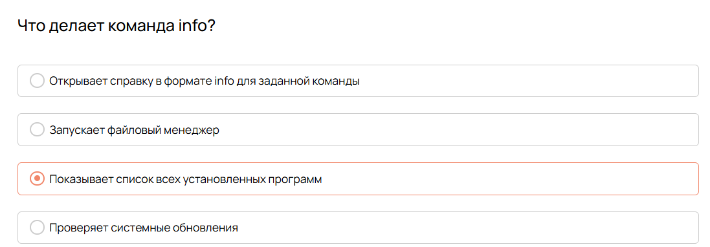

**Вопрос 3. Где чаще всего находятся текстовые справочные файлы (документация) к установленным программам в Linux?**
Правильный ответ: /usr/share/doc.

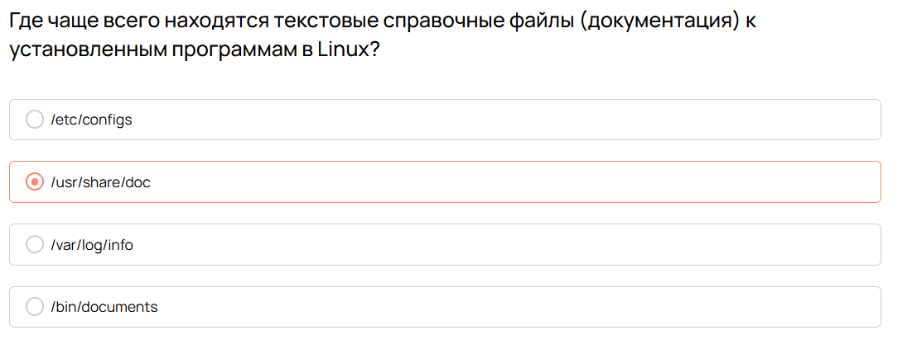

---

### Задания по теме «Работа с текстовыми файлами в Linux»

**Задание №1. Открытие файла /etc/os-release с помощью less**

less /etc/os-release

**Задание №2. Поиск строк с «error» в системном логе**

grep "error" /var/log/syslog
grep -i "error" /var/log/syslog

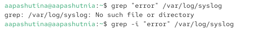

**Задание №3. Редактирование конфигурации SSH**

sudo nano /etc/ssh/sshd_config

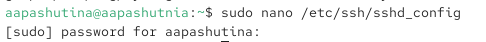

**Задание №4. Создание матрицы чисел и подсчет суммы в четных строках с помощью awk**

cat > matrix.txt
1 2 3
4 5 6
7 8 9
10 11 12

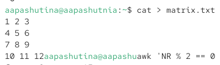

Применяем awk:

awk 'NR % 2 == 0 { sum = 0; for(i = 1; i <= NF; i++) sum += $i; print "Строка", NR, "сумма:", sum }' matrix.txt

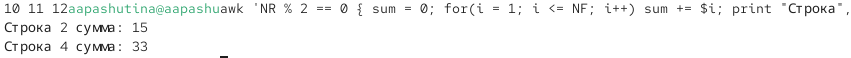

### Тест по теме «Работа с текстовыми файлами в Linux»

**Вопрос 1. Что делает команда cat > файл.txt?**
Правильный ответ: создает новый файл и записывает в него.

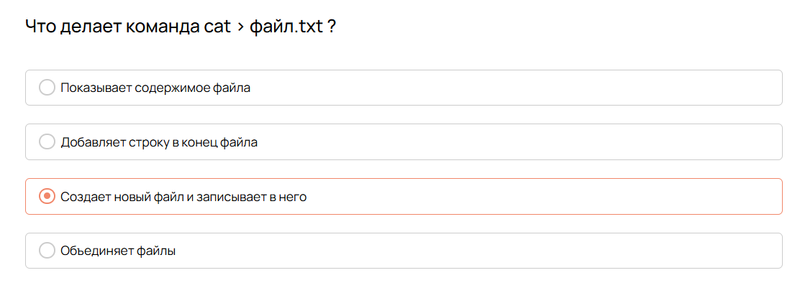

**Вопрос 2. Чем отличается cat >> файл.txt от cat > файл.txt?**
Правильный ответ: >> дописывает в конец, > — перезаписывает.

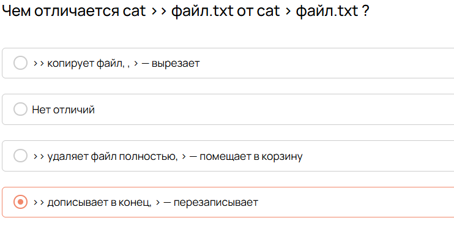

**Вопрос 3. Чем less отличается от cat при просмотре больших файлов?**
Правильный ответ: less показывает содержимое файла постранично с навигацией и поиском.

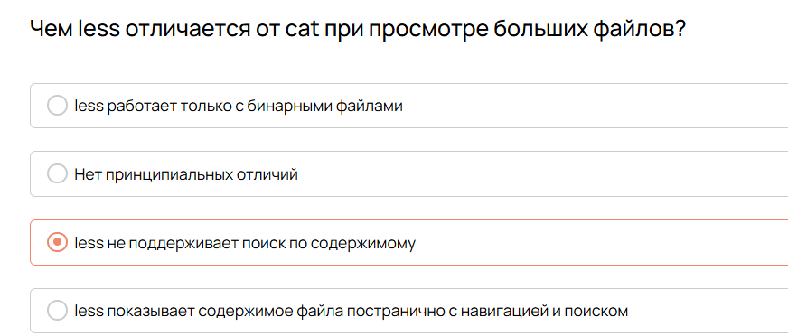

**Вопрос 4. Какой клавишей можно выйти из утилиты less?**
Правильный ответ: q.

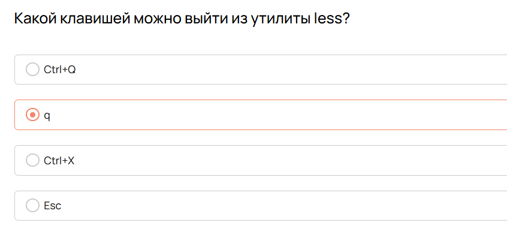

**Вопрос 5. С помощью какой клавиши в Vim можно переключиться из Normal mode в Command mode?**
Правильный ответ: :.

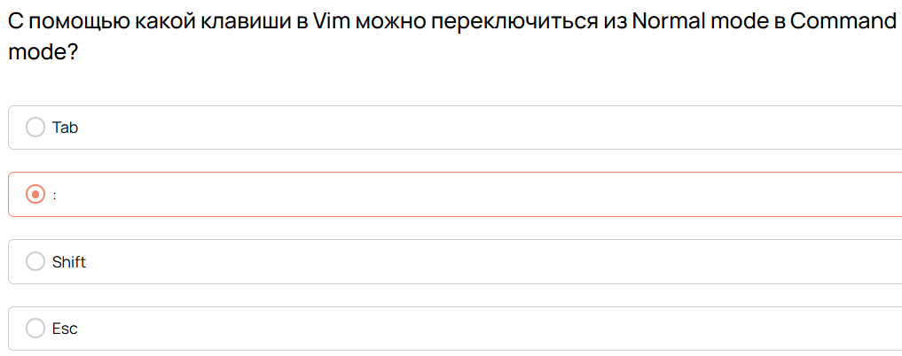

---

### Задания по теме «Анализ системных логов»

**Задание №1. Поиск всех ошибок в системном журнале за последний день**

journalctl --since "yesterday" --grep error

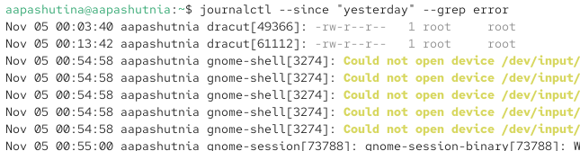

**Задание №2. Проверка логов SSH и поиск неудачных попыток входа**

journalctl -u ssh --grep "Failed password"

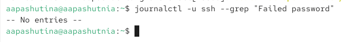

### Тест по теме «Анализ системных логов»

**Вопрос 1. Где хранятся основные лог-файлы в Linux?**
Правильный ответ: /var/log/.

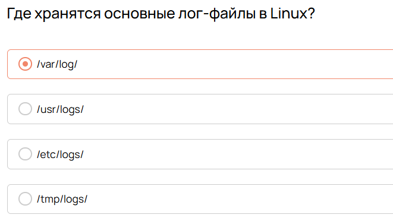

**Вопрос 2. Что делает команда journalctl -u sshd --since today?**
Правильный ответ: показывает логи sshd за сегодня.

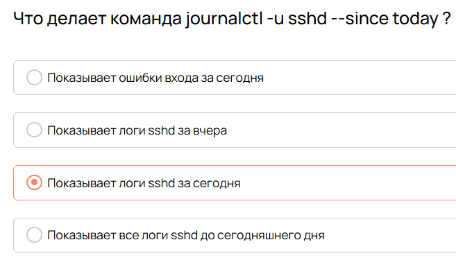

**Вопрос 3. Какой параметр journalctl показывает последние 20 записей?**
Правильный ответ: -n 20.

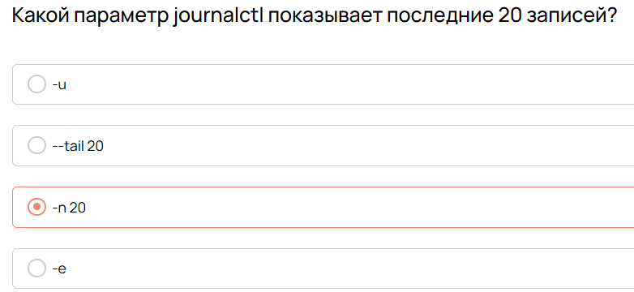

---

### Задания по теме «Автоматизация анализа логов и работы с текстом»

**Задание №1. Написание скрипта для ежедневного сохранения ошибок**

nano /usr/local/bin/save_syslog_errors.sh

Содержимое скрипта:

#!/bin/bash
grep -i "error" /var/log/syslog > /var/log/daily_errors.log

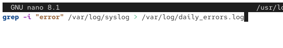

**Задание №2. Настройка cron для ежедневного выполнения скрипта**

sudo crontab -e

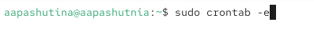

**Задание №3. Использование awk для подсчета неудачных попыток входа**

grep "$(date --date='1 day ago' '+%b %e')" /var/log/auth.log | grep "Failed password" | wc -l

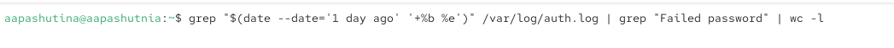

### Тест по теме «Автоматизация анализа логов и работы с текстом»

**Вопрос 1. Какая команда позволяет в реальном времени отслеживать новые строки в лог-файле?**
Правильный ответ: tail -f /var/log/nginx.log.

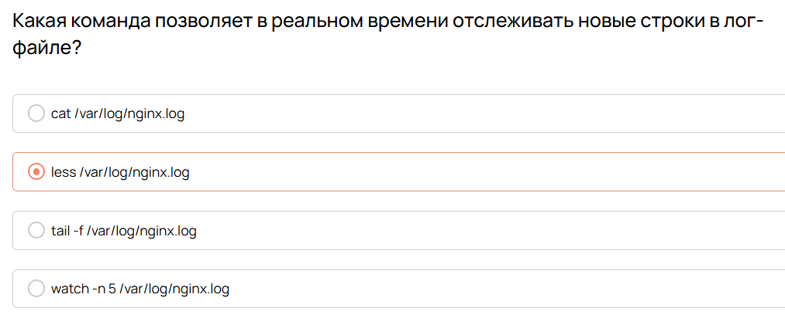

**Вопрос 2. Где по умолчанию хранятся пользовательские задания cron?**
Правильный ответ: /var/spool/cron/.

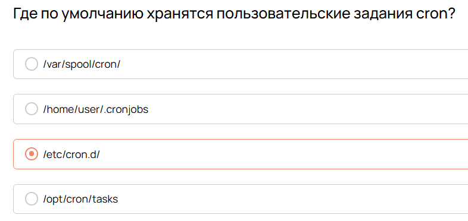

**Вопрос 3. Какой символ в crontab означает «любое значение»?**
Правильный ответ: *.

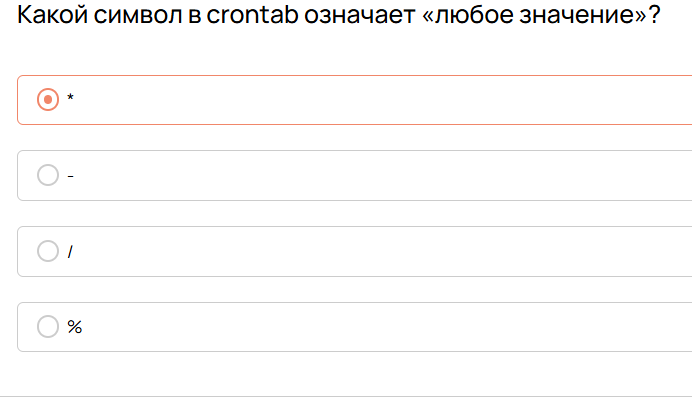

**Вопрос 4. Как удалить все задания cron для текущего пользователя?**
Правильный ответ: crontab -r.

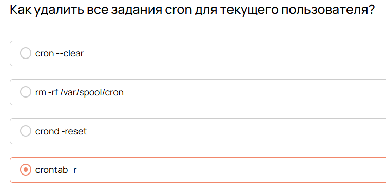

---

## Модуль 5: Управление пользователями и группами

### Задания по теме «Основы управления пользователями и группами»

**Задание №1. Создание нового пользователя ivan**

sudo adduser ivan

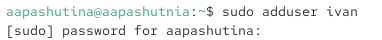

**Задание №2. Создание новой группы developers**

sudo addgroup developers

**Задание №3. Добавление пользователя ivan в группу developers**

sudo usermod -aG developers ivan

**Задание №4. Создание группы testers и смена принадлежности пользователя ivan**

sudo addgroup testers

**Задание №5. Удаление учетной записи пользователя ivan вместе с домашним каталогом**

sudo deluser --remove-home ivan

### Тест по теме «Основы управления пользователями и группами»

**Вопрос 1. Какой флаг команды useradd используется для создания домашней директории пользователя?**
Правильный ответ: -m.

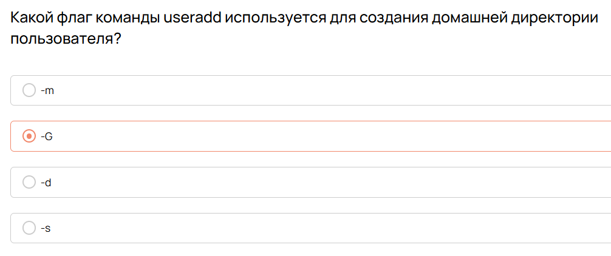

**Вопрос 2. Какая команда удалит пользователя вместе с его домашней директорией?**
Правильный ответ: sudo userdel -r admin.

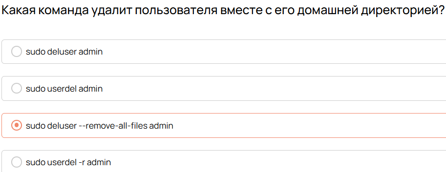

**Вопрос 3. Что делает команда sudo usermod -aG sudo admin?**
Правильный ответ: добавляет пользователя admin в группу sudo, сохранив остальные группы.

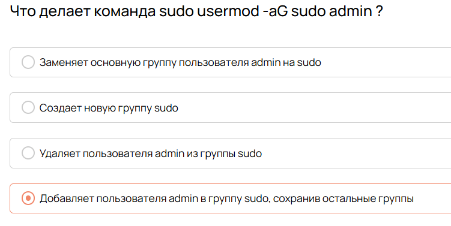

**Вопрос 4. Какая команда используется для безопасного редактирования файла /etc/passwd?**
Правильный ответ: vipw.

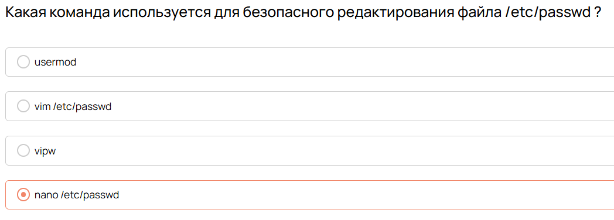

---

### Задания по теме «Основы управления доступом и разрешениями»

**Задание №1. Создание нового файла и анализ разрешений**

cd ~
touch sample.txt
ls -l sample.txt
umask

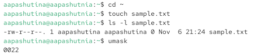

**Задание №2. Удаление прав на запись для группы и чтение для остальных**

chmod g-w,o-r sample.txt
ls -l sample.txt

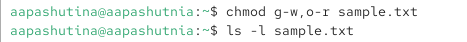

**Задание №3. Возврат первоначальных прав с использованием числовой формы**

umask
chmod 644 sample.txt

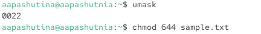

**Задание №4. Смена владельца файла на пользователя root**

sudo chown root sample.txt

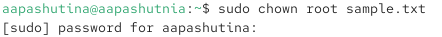

**Задание №5. Возврат владения файлом текущему пользователю**

whoami
sudo chown aapashutina sample.txt

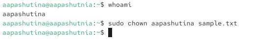

### Тест по теме «Основы управления доступом и разрешениями»

**Вопрос 1. Что означает первый символ d в строке прав доступа при выполнении команды ls -l?**
Правильный ответ: директория (каталог).

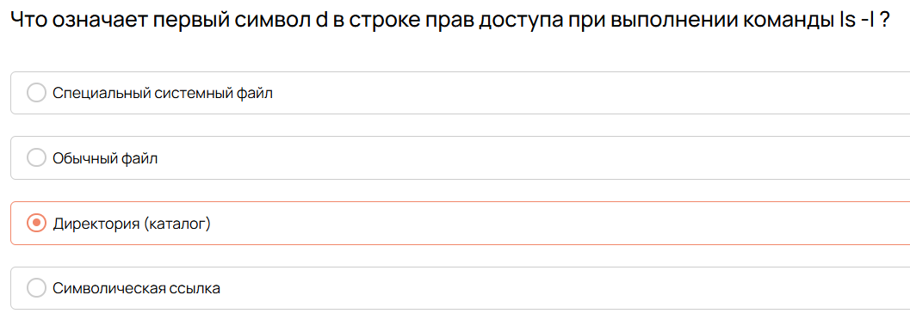

**Вопрос 2. Какая команда сменит владельца и группу файла /home/ivan/file.txt на ivan и friends соответственно?**
Правильный ответ: chown ivan:friends /home/ivan/file.txt.

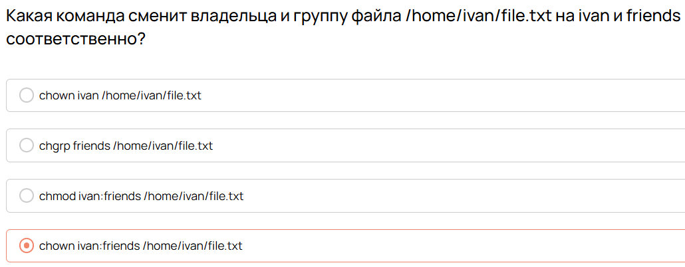

**Вопрос 3. Какие права доступа соответствуют числовому значению 754?**
Правильный ответ: rwxr-xr--.

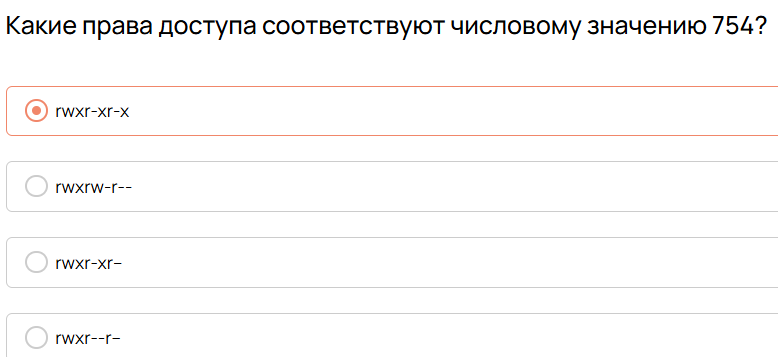

---

### Задания по теме «Повышение безопасности работы с учетными записями»

**Задание №1. Выполнение действий через sudo и поиск их в системном журнале**

sudo ls /root
sudo apt update
sudo systemctl status ssh
sudo journalctl _COMM=sudo

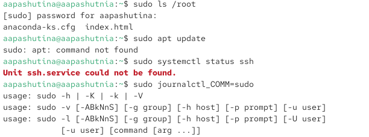

**Задание №2. Проверка прав пользователя ivan и предоставление ему доступа к sudo**

sudo adduser ivan
sudo -u ivan ls /root
sudo -u ivan sudo ls /root

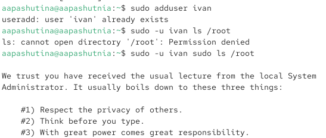

### Тест по теме «Повышение безопасности работы с учетными записями»

**Вопрос 1. Что произойдет, если вы используете команду sudo для выполнения действий?**
Правильный ответ: будет зафиксировано, кто и когда выполнил команду с правами суперпользователя.

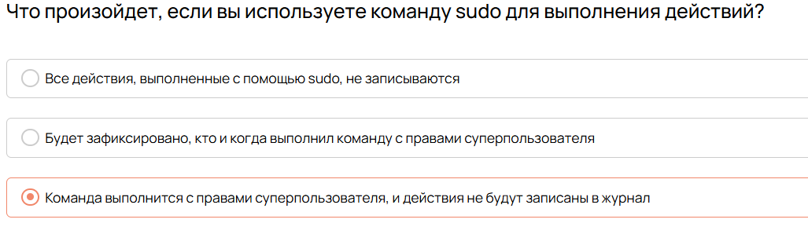

**Вопрос 2. Что произойдет, если вы измените порт SSH с 22 на 47022, но не обновите файрвол?**
Правильный ответ: SSH будет работать на новом порту, но файрвол не разрешит подключения.

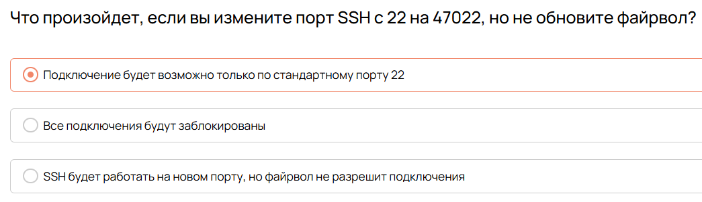

**Вопрос 3. Какую команду следует выполнить для того, чтобы добавить в файрвол ufw разрешение на подключение к нестандартному порту 47022 по протоколу TCP?**
Правильный ответ: sudo ufw allow 47022/tcp.

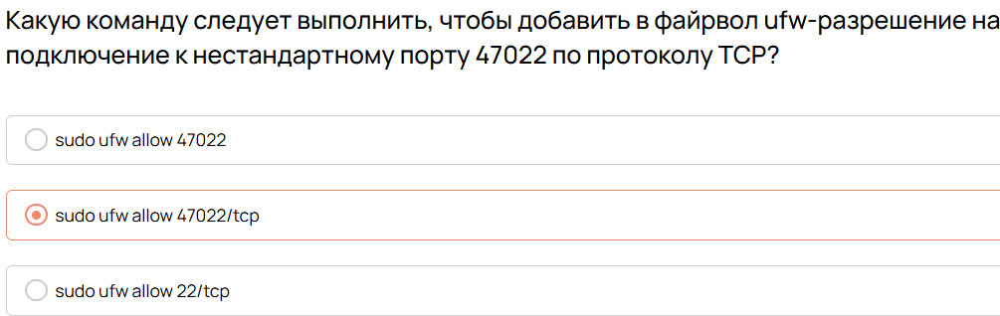

**Вопрос 4. Почему рекомендуется использовать sudo, а не su?**
Правильный ответ: sudo не требует ввода пароля root, а выполняемые команды журналируются, обеспечивая прозрачность действий.

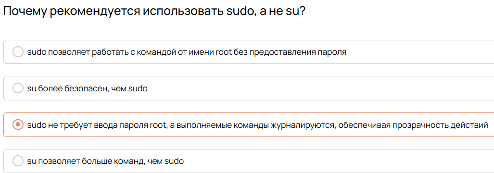

---

### Задания по теме «Политика паролей и учетных записей»

**Задание №1. Поиск пользователей с устаревшим алгоритмом хеширования SHA-512**

cat /etc/shadow
awk -F: '$2 ~ /^\$6\$/ {print $1}' /etc/shadow

**Задание №2. Установка параметров политики паролей для пользователя ivan**

sudo adduser ivan
sudo chage -M 60 -m 5 -W 10 ivan
chage -l ivan

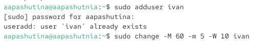

**Задание №3. Блокировка входа пользователю ivan**

sudo usermod -L ivan

**Задание №4. Разблокировка пользователя ivan**

sudo usermod -U ivan

### Тест по теме «Политика паролей и учетных записей»

**Вопрос 1. Какой из следующих вариантов наиболее точно описывает хеширование пароля?**
Правильный ответ: пароль преобразуется в уникальный отпечаток, который нельзя восстановить обратно.

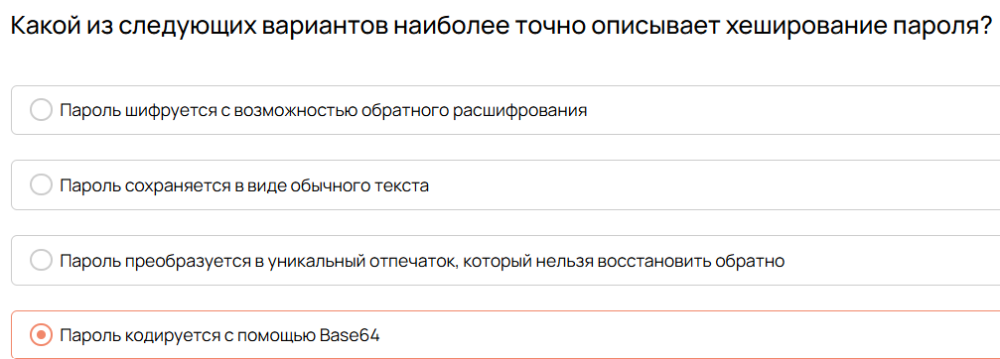

**Вопрос 2. Что обозначает первая часть строки пароля в /etc/shadow, которая начинается с символа $ (например, $y)?**
Правильный ответ: используемый алгоритм хеширования.

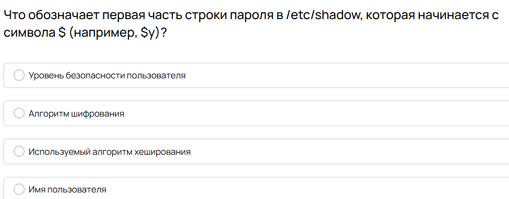

**Вопрос 3. Какова функция «соли» (salt) при хешировании пароля?**
Правильный ответ: сделать каждый хеш уникальным и предотвратить атаки с использованием rainbow-таблиц.

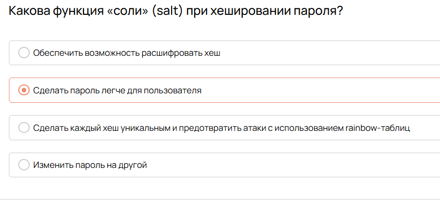

**Вопрос 4. Какая команда позволяет просмотреть текущие параметры политики пароля для пользователя ivan?**
Правильный ответ: chage -l ivan.

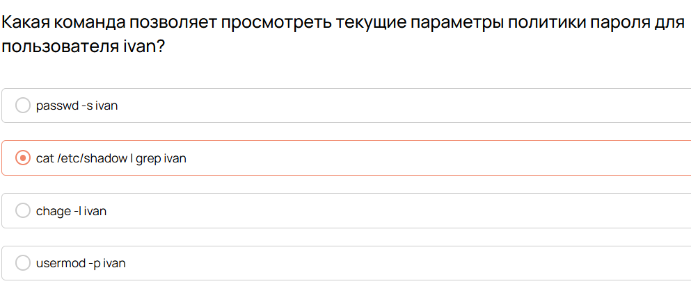

**Вопрос 5. Что произойдет после выполнения команды sudo usermod -L username?**
Правильный ответ: учетная запись будет заблокирована, и вход станет невозможным.

---

## Модуль 6: Управление доступом

### Задания по теме «Что такое права доступа в Linux»

**Задание №1. Проверка прав доступа к /etc/passwd, /home и /var/log**

ls -l /etc/passwd
ls -l /home
ls -ld /home
ls -l /var/log
ls -ld /var/log

**Задание №2. Создание файла, проверка прав и настройка umask**

pwd
touch file1
ls -l | grep file1
umask 006
touch file2
ls -l | grep file2

### Тест по теме «Что такое права доступа в Linux»

**Вопрос 1. Какую команду надо ввести, чтобы посмотреть, какие права выданы файлам?**
Правильный ответ: ls -l.

**Вопрос 2. Какую команду надо ввести, чтобы посмотреть, какие права выданы файлам, в том числе — скрытым?**
Правильный ответ: ls -la.

**Вопрос 3. Как будут записаны права r w - в восьмеричном формате?**
Правильный ответ: 6.

---

### Задания по теме «Изменение прав доступа: chmod, chown, chgrp»

**Задание №1. Создание файла и настройка прав 644**

touch file1
chmod 644 file1

**Задание №2. Создание группы admins и изменение группы файла**

sudo addgroup admins
sudo chgrp admins file1
chmod g+w file1

### Тест по теме «Изменение прав доступа: chmod, chown, chgrp»

**Вопрос 1. Какую команду нужно использовать для изменения прав файлов и каталогов?**
Правильный ответ: chmod.

**Вопрос 2. С помощью каких операторов можно указать тип изменения прав?**
Правильный ответ: + - =.

**Вопрос 3. Какую опцию нужно применить, чтобы изменить права не только к текущему каталогу, но и ко всем вложенным?**
Правильный ответ: -R.

---

### Задания по теме «Расширенные списки доступа (ACL) для управления доступом»

**Задание №1. Разрешение конкретному пользователю изменять файл**

setfacl -m user2:w file1

**Задание №2. Установка особых прав для группы**

setfacl -m g:test-group:x file1

**Задание №3. Проверка и сброс всех ACL с файла**

getfacl file1
setfacl -b file1
getfacl file1

---

### Задания по теме «Специальные разрешения: SUID, SGID, Sticky Bit»

**Задание №1. Установка SUID на исполняемый файл**

chmod u+x file1
chmod u+s file1

**Задание №2. Настройка SGID для каталога**

chmod g+x directory1
chmod g+s directory1

**Задание №3. Настройка Sticky Bit для каталога /public_folder**

chmod o=wx /public_folder
chmod +t /public_folder

### Тест по теме «Специальные разрешения: SUID, SGID, Sticky Bit»

**Вопрос 1. Как называется специальное разрешение, благодаря которому файлы в каталоге, которому выставлен этот бит разрешения, могут быть удалены только их владельцами или владельцами каталога, где лежит этот файл?**
Правильный ответ: Sticky Bit.

**Вопрос 2. Как называется параметр безопасности, благодаря которому можно разрешить пользователям запускать программу от имени владельца?**
Правильный ответ: SUID.

**Вопрос 3. Как называется параметр безопасности, благодаря которому можно разрешить пользователям запускать файл от имени владельца группы файла? При условии, что права на выполнение не выданы изначально.**
Правильный ответ: нет правильного ответа.

---

## Модуль 7: Управление процессами

### Тест по теме «Основы управления процессами в Linux»

**Вопрос 1. Какой командой можно вывести список всех процессов с детальной информацией об использовании CPU и памяти?**
Правильный ответ: ps aux.

**Вопрос 2. Какой сигнал отправляется процессу командой kill -9?**
Правильный ответ: SIGKILL (9).

**Вопрос 3. Какой командой можно приостановить выполнение процесса и перевести его в фон?**
Правильный ответ: Ctrl+Z, затем bg %1.

---

### Тест по теме «Управление приоритетами процессов: nice и renice»

**Вопрос 1. Какое значение nice имеет наивысший приоритет?**
Правильный ответ: -20.

**Вопрос 2. Какой командой изменить приоритет уже запущенного процесса с PID 1234 на nice=10?**
Правильный ответ: renice -n 10 -p 1234.

**Вопрос 3. Какой параметр в unit-файле systemd устанавливает приоритет CPU для сервиса?**
Правильный ответ: Nice=10.

---

### Задания по теме «Контроль системных сервисов: systemd и systemctl»

**Задание №1. Вывод списка активных сервисов с фильтрацией по «Network»**

systemctl list-units --type=service --state=running | grep Network

**Задание №2. Определение веб-сервера, проверка статуса и перезапуск**

systemctl status nginx apache2

**Задание №3. Отключение ненужного сервиса и проверка автозапуска**

systemctl list-unit-files --type=service | grep enabled

### Тест по теме «Контроль системных сервисов: systemd и systemctl»

**Вопрос 1. Какой командой проверить статус сервиса nginx?**
Правильный ответ: systemctl status nginx.

**Вопрос 2. Какой параметр в таймере systemd указывает ежедневный запуск в полночь?**
Правильный ответ: OnCalendar=daily.

**Вопрос 3. Какой командой включить автозапуск сервиса при загрузке системы?**
Правильный ответ: systemctl enable servicename.

---

### Тест по теме «Управление фоновыми процессами (демонами) в Linux»

**Вопрос 1. Какой параметр в unit-файле обеспечивает перезапуск сервиса при любом завершении?**
Правильный ответ: Restart=always.

**Вопрос 2. Какой командой просмотреть логи сервиса в реальном времени?**
Правильный ответ: journalctl -u servicename -f.

**Вопрос 3. Какой командой проверить синтаксис unit-файла перед запуском?**
Правильный ответ: systemd-analyze verify mydaemon.service.

---

### Задания по теме «Управление приоритетами процессов: nice и renice»

**Задание №1. Запуск процесса с пониженным приоритетом**

nice -n 15 dd if=/dev/urandom of=/dev/null &

**Задание №2. Поиск процесса по имени**

pgrep dd

**Задание №3. Поиск процессов с определенным значением nice**

ps -eo pid,ni,cmd | awk '$2==19'

---

## Итоги

В ходе прохождения Части 2 внешнего курса «Системный администратор Linux с нуля» были освоены:

- поиск справочной информации с помощью man и info;
- работа с текстовыми файлами и системными логами;
- управление пользователями, группами и правами доступа;
- управление процессами и системными службами.

Все тесты и интерактивные задания Части 2 пройдены. Цель работы достигнута.