

📖 Оглавление

- [Модуль 8: Настройка сети и SSH](#модуль-8-настройка-сети-и-ssh)
- [Модуль 9: Управление пакетами](#модуль-9-управление-пакетами)
- [Модуль 10: Управление логами](#модуль-10-управление-логами)
- [Модуль 11: Контейнеризация](#модуль-11-контейнеризация)
- [Финальный тест](#финальный-тест)
- [Итоги](#итоги)

 

## Модуль 8: Настройка сети и SSH

### Задания по теме «Основы сетевой конфигурации в Linux»

**Задание №1. Настройка статического IP на тестовом сервере вручную**

sudo ip a add 192.168.122.2/24 dev enp0s3

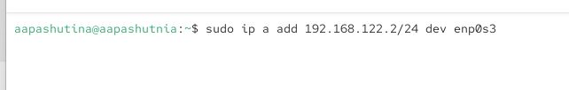

**Пояснение:** команда `ip a add` добавляет указанный IP-адрес к сетевому интерфейсу.

**Задание №2. Прописывание конфигурации в файле /etc/network/interfaces**

sudo nano /etc/network/interfaces

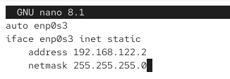

**Пояснение:** в файле задаются параметры статической конфигурации для интерфейса `enp0s3`.

**Задание №3. Проверка доступности внешних ресурсов через ping**

ping selectel.ru

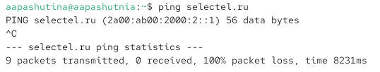

**Пояснение:** команда `ping` отправляет ICMP-пакеты на указанный хост.

**Задание №4. Удаление текущего IP-адреса с интерфейса**

sudo ip a del 192.168.122.2/24 dev enp0s3

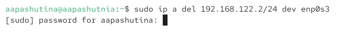

**Пояснение:** команда `ip a del` удаляет указанный IP-адрес с сетевого интерфейса.

### Тест по теме «Основы сетевой конфигурации в Linux»

**Вопрос 1. Какой командой можно назначить IP-адрес вручную?**
Правильный ответ: `ip a add 192.168.122.2/24 dev eth0`.

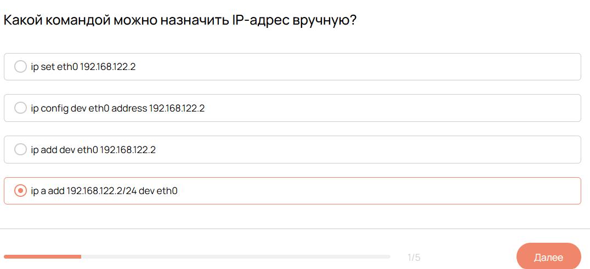

**Вопрос 2. Что делает директива auto eth0 в /etc/network/interfaces?**
Правильный ответ: Поднимает интерфейс автоматически при загрузке системы.

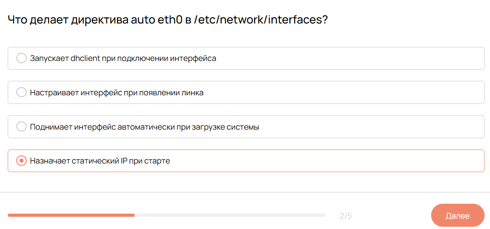

**Вопрос 3. Какая команда используется для удаления IP с интерфейса?**
Правильный ответ: `ip a del 192.168.122.2/24 dev eth0`.

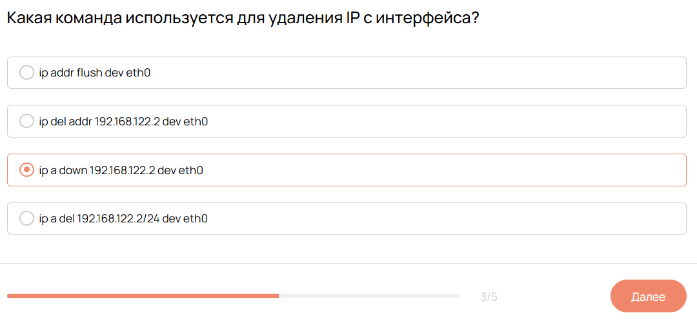

**Вопрос 4. Что произойдет при перезагрузке, если IP-адрес был задан только через ip?**
Правильный ответ: IP-адрес исчезнет.

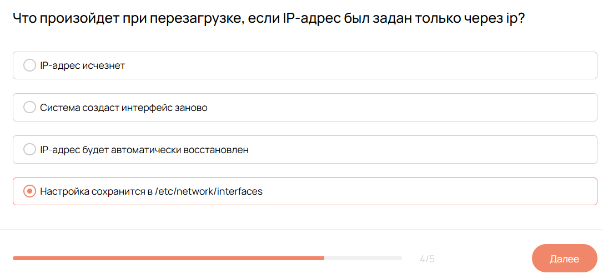

**Вопрос 5. Где задается шлюз по умолчанию в конфигурации интерфейса?**
Правильный ответ: В поле gateway в /etc/network/interfaces.

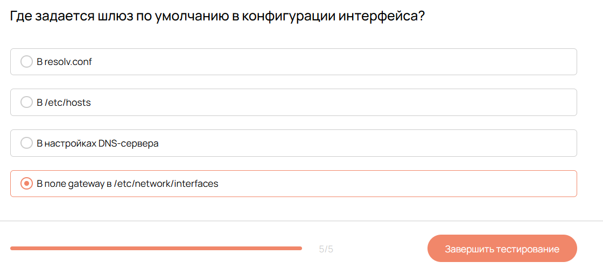

---

### Задания по теме «Базовая диагностика сети»

**Задание №1. Запуск веб-сервера на 80 порту и проверка его работы**

sudo dnf install nginx -y
sudo systemctl start nginx
ss -tulnp | grep :80

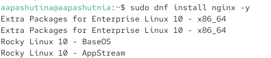
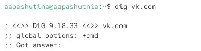

**Пояснение:** команда `ss -tulnp` показывает все открытые порты и процессы, которые их слушают.

**Задание №2. Использование утилиты dig для получения IP-адресов**

dig vk.com

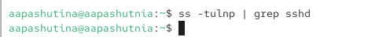

**Пояснение:** команда `dig` выполняет DNS-запрос и отображает информацию о домене.

**Задание №3. Проверка, слушает ли SSH-порт на сервере**

ss -tulnp | grep sshd

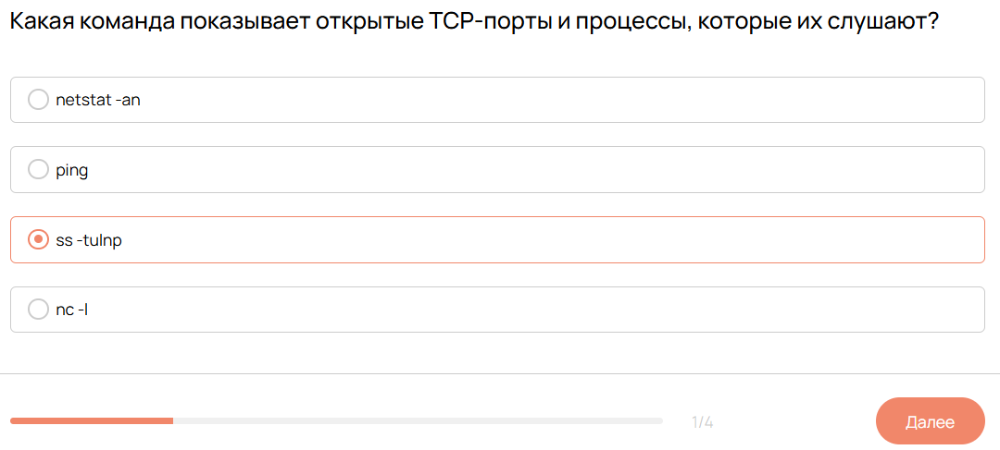

**Пояснение:** если вывод пуст, значит, SSH-сервер не запущен или слушает другой порт.

### Тест по теме «Базовая диагностика сети»

**Вопрос 1. Какая команда показывает открытые TCP-порты и процессы, которые их слушают?**
Правильный ответ: `ss -tulnp`.

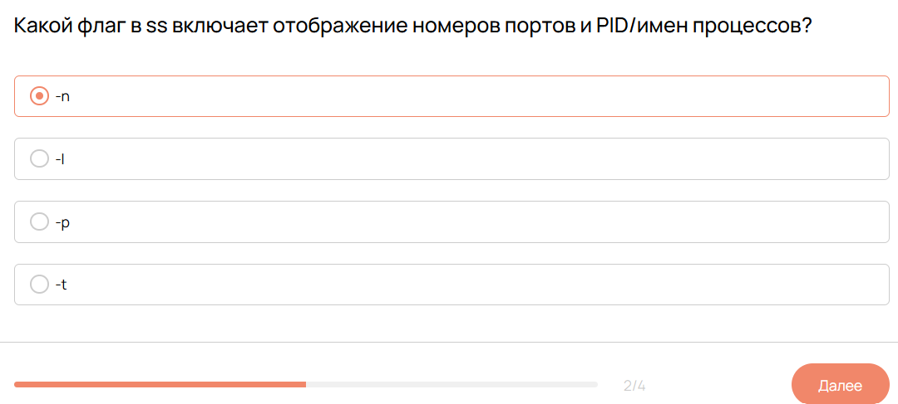

**Вопрос 2. Какой флаг в ss включает отображение номеров портов и PID/имен процессов?**
Правильный ответ: `-p`.

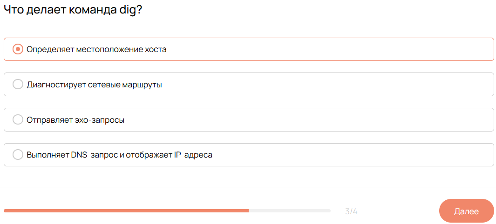

**Вопрос 3. Что делает команда dig?**
Правильный ответ: Выполняет DNS-запрос и отображает IP-адреса.

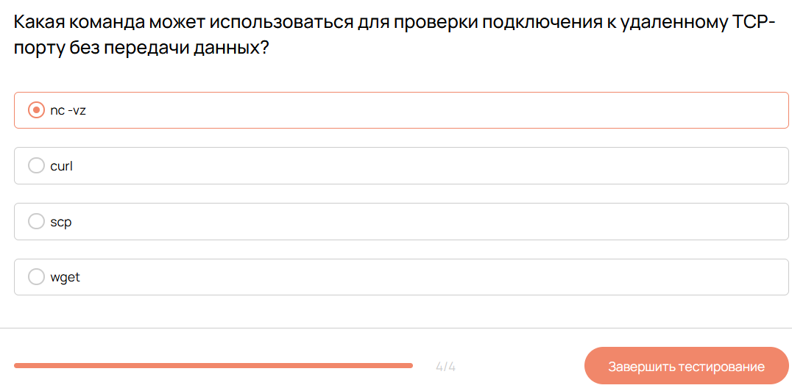

**Вопрос 4. Какая команда может использоваться для проверки подключения к удаленному TCP-порту без передачи данных?**
Правильный ответ: `nc -vz`.

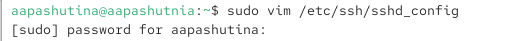

---

### Задания по теме «Настройка SSH-доступа и его защита»

**Задание №1. Изменение порта SSH и запрет входа по паролю**

sudo vim /etc/ssh/sshd_config

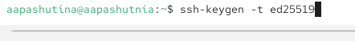

**Пояснение:** в файле необходимо изменить параметр `Port` и установить `PasswordAuthentication no`.

**Задание №2. Настройка подключения по ключу**

ssh-keygen -t ed25519

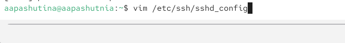

**Пояснение:** команда создаёт пару ключей для аутентификации по ключу.

**Задание №3. Разрешение SSH-доступа только для определённых пользователей**

sudo vim /etc/ssh/sshd_config

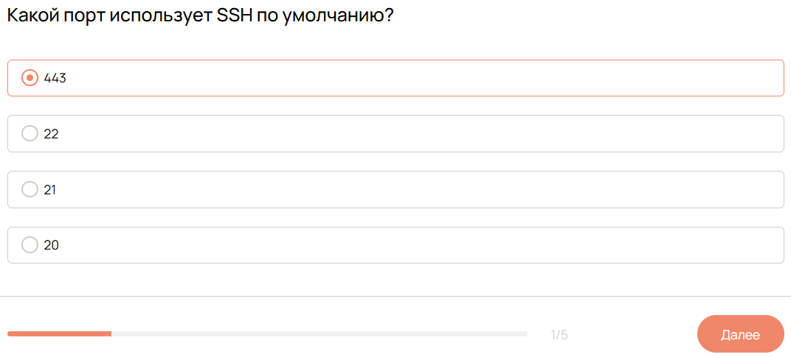

**Пояснение:** в файле добавляется строка `AllowUsers trex` и выполняется перезапуск службы.

### Тест по теме «Настройка SSH-доступа и его защита»

**Вопрос 1. Какой порт использует SSH по умолчанию?**
Правильный ответ: 22.

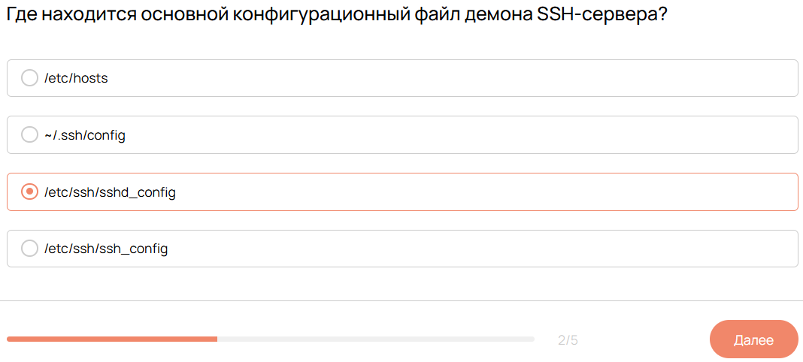

**Вопрос 2. Где находится основной конфигурационный файл демона SSH-сервера?**
Правильный ответ: `/etc/ssh/sshd_config`.

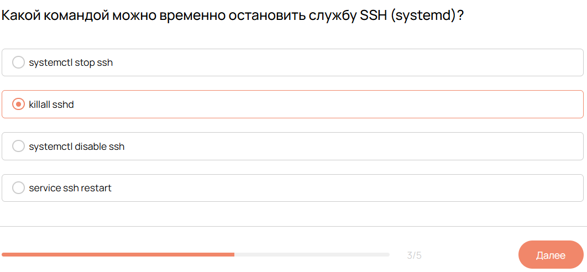

**Вопрос 3. Какой командой можно временно остановить службу SSH (systemd)?**
Правильный ответ: `systemctl stop ssh`.

**Вопрос 4. Какой файл публичного ключа нужно добавить на сервер для авторизации по ключу?**
Правильный ответ: `id_rsa.pub`.

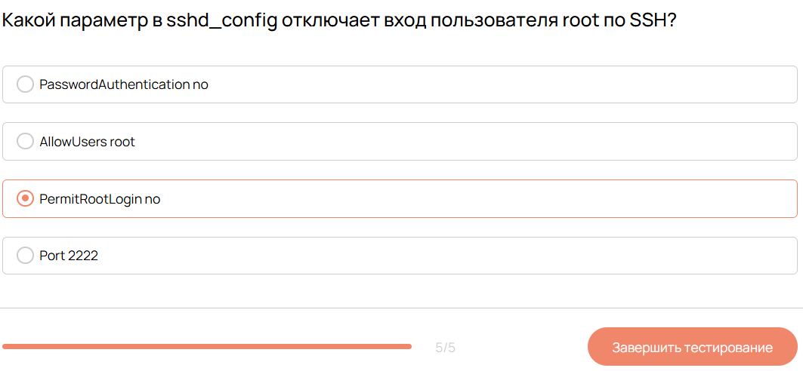

**Вопрос 5. Какой параметр в sshd_config отключает вход пользователя root по SSH?**
Правильный ответ: `PermitRootLogin no`.

---

### Задания по теме «Повышение безопасности сетевого взаимодействия»

**Задание №1. Настройка UFW для ограничения доступа только для SSH**

ufw deny ssh

**Пояснение:** команда `ufw deny ssh` запрещает входящие подключения по SSH.

**Задание №2. Настройка UFW для доступа по SSH только из локальной сети**

ufw allow from 192.168.122.0/24 to any port 22 proto tcp

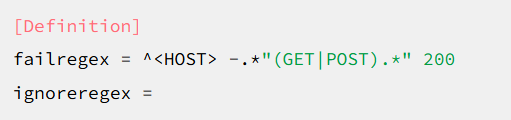

**Пояснение:** команда разрешает подключения к порту 22 только с указанной подсети.

**Задание №3. Создание jail в fail2ban для блокировки после трёх запросов к nginx**

[Definition]
failregex = ^<HOST> -.*"(GET|POST).*" 200
ignoreregex =

**Пояснение:** фильтр ищет в логах nginx строки с успешными запросами и блокирует IP после 3 попыток.

### Тест по теме «Повышение безопасности сетевого взаимодействия»

**Вопрос 1. Какой командой включить (activate) файрвол UFW?**
Правильный ответ: `ufw enable`.

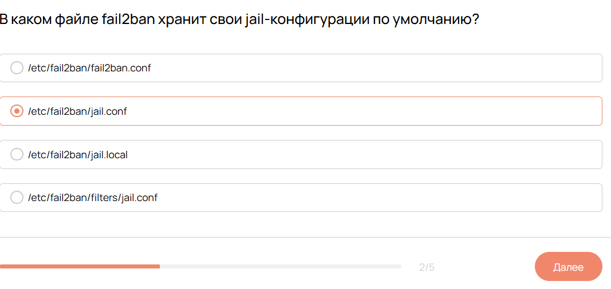

**Вопрос 2. В каком файле fail2ban хранит свои jail-конфигурации по умолчанию?**
Правильный ответ: `/etc/fail2ban/jail.conf`.

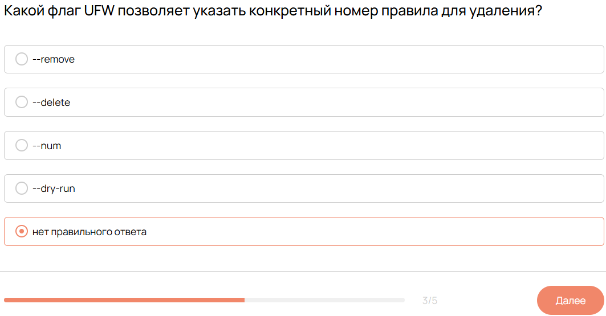

**Вопрос 3. Какой флаг UFW позволяет указать конкретный номер правила для удаления?**
Правильный ответ: нет правильного ответа.

**Вопрос 4. Какой параметр в jail-файле fail2ban задает время блокировки IP в секундах?**
Правильный ответ: `bantime`.

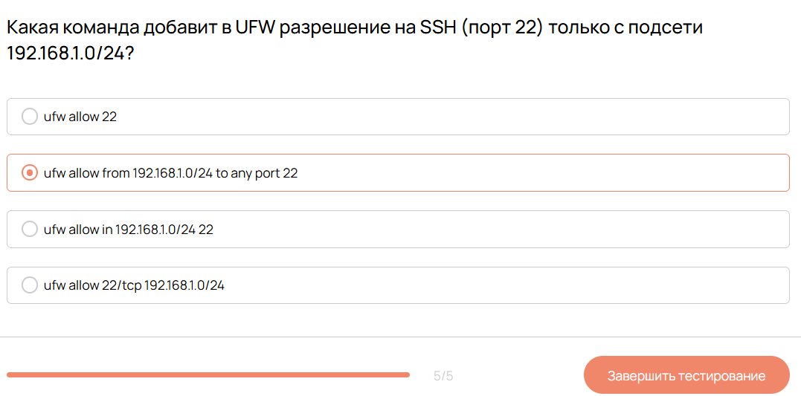

**Вопрос 5. Какая команда добавит в UFW разрешение на SSH (порт 22) только с подсети 192.168.1.0/24?**
Правильный ответ: `ufw allow from 192.168.1.0/24 to any port 22`.

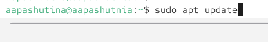

---

## Модуль 9: Управление пакетами

### Задания по теме «Что такое пакеты и как они устроены»

**Задание №1. Поиск и установка утилиты htop**

sudo apt update
sudo apt install htop

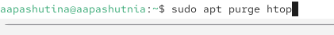
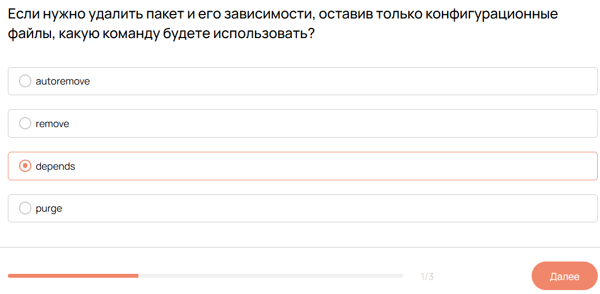

**Пояснение:** команда `apt install` устанавливает указанный пакет.

**Задание №2. Удаление htop и установка заново с полной очисткой**

sudo apt purge htop
sudo apt autoremove --purge
sudo apt install htop

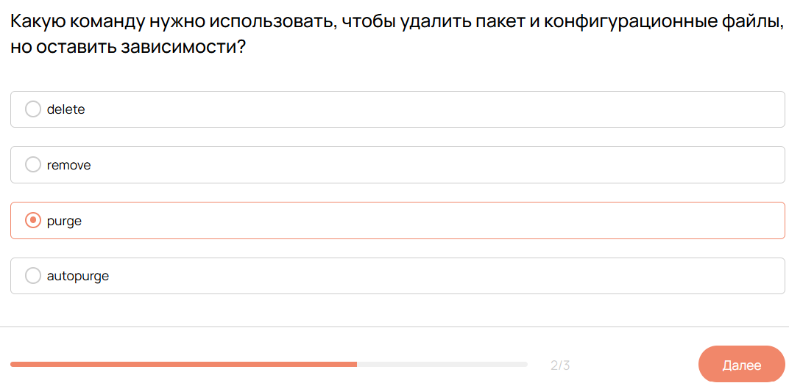

**Пояснение:** команда `purge` удаляет пакет вместе с конфигурационными файлами.

### Тест по теме «Что такое пакеты и как они устроены»

**Вопрос 1. Если нужно удалить пакет и его зависимости, оставив только конфигурационные файлы, какую команду будете использовать?**
Правильный ответ: autoremove.

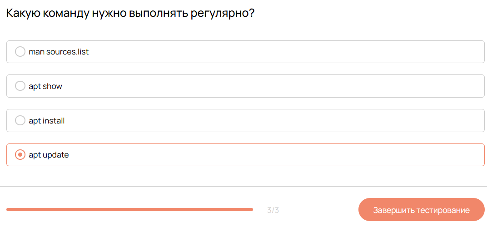

**Вопрос 2. Какую команду нужно использовать, чтобы удалить пакет и конфигурационные файлы, но оставить зависимости?**
Правильный ответ: purge.

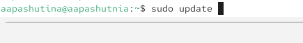

**Вопрос 3. Какую команду нужно выполнять регулярно?**
Правильный ответ: apt update.

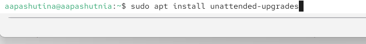

---

### Задания по теме «Обновление системы и безопасность»

**Задание №1. Полное обновление системы**

sudo apt update
sudo apt upgrade

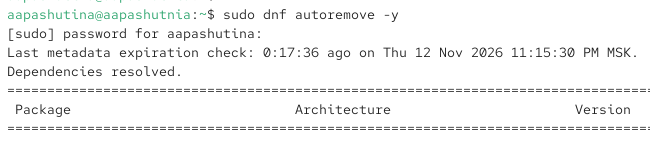

**Пояснение:** команда `apt upgrade` устанавливает новые версии пакетов.

**Задание №2. Настройка автоматической установки обновлений безопасности**

sudo apt install unattended-upgrades
sudo dpkg-reconfigure unattended-upgrades

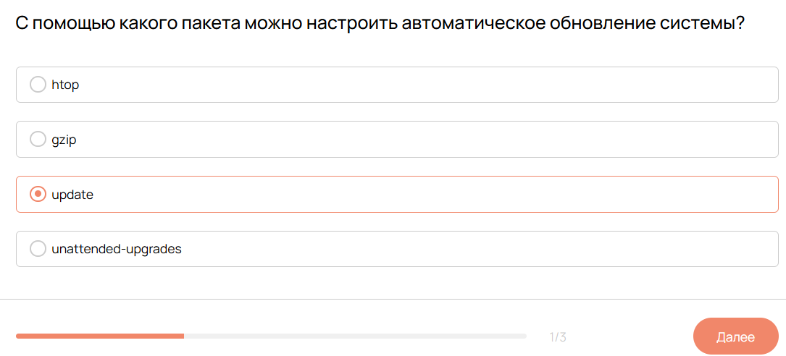

**Пояснение:** пакет `unattended-upgrades` позволяет настроить автоматическую установку обновлений.

**Задание №3. Удаление устаревших и неиспользуемых зависимостей**

sudo apt autoremove -y

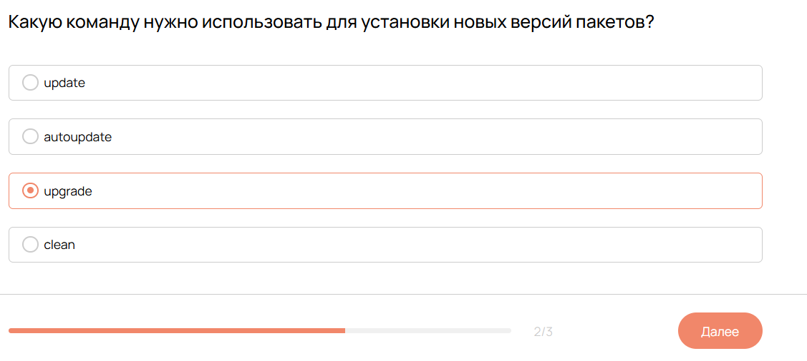

**Пояснение:** команда `apt autoremove` удаляет ненужные зависимости.

### Тест по теме «Обновление системы и безопасность»

**Вопрос 1. С помощью какого пакета можно настроить автоматическое обновление системы?**
Правильный ответ: unattended-upgrades.

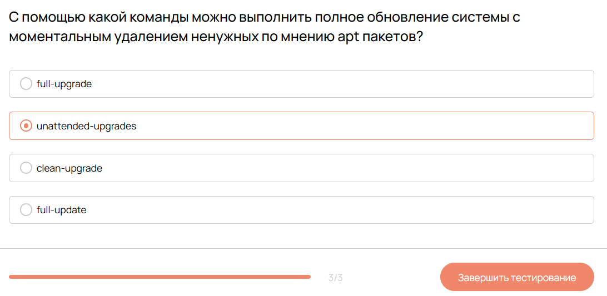

**Вопрос 2. Какую команду нужно использовать для установки новых версий пакетов?**
Правильный ответ: upgrade.

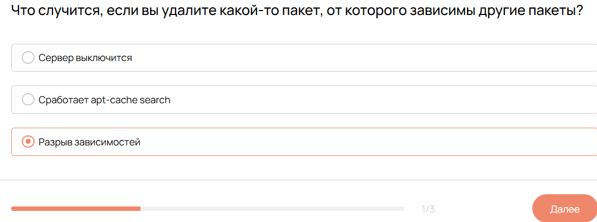

**Вопрос 3. С помощью какой команды можно выполнить полное обновление системы с моментальным удалением ненужных по мнению apt пакетов?**
Правильный ответ: full-upgrade.

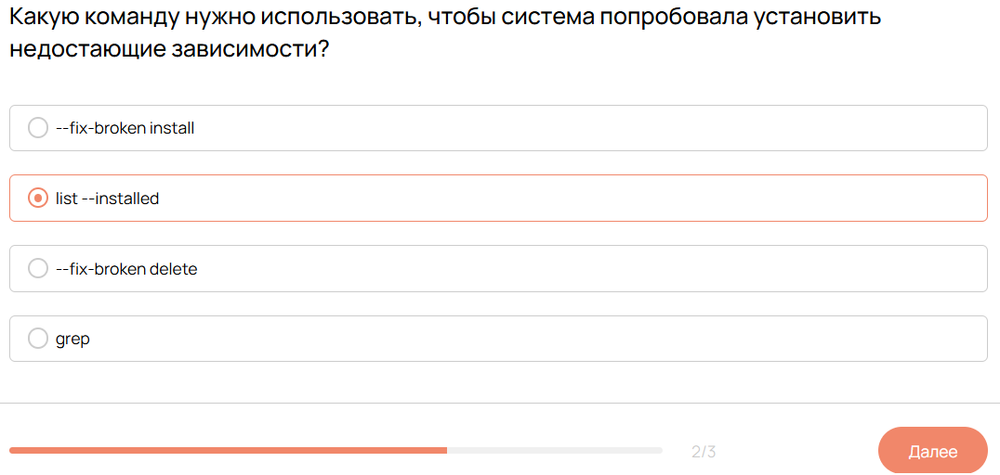

---

### Задания по теме «Работа с зависимостями и решение конфликтов»

**Задание №1. Установка недостающих зависимостей**

sudo apt --fix-broken install

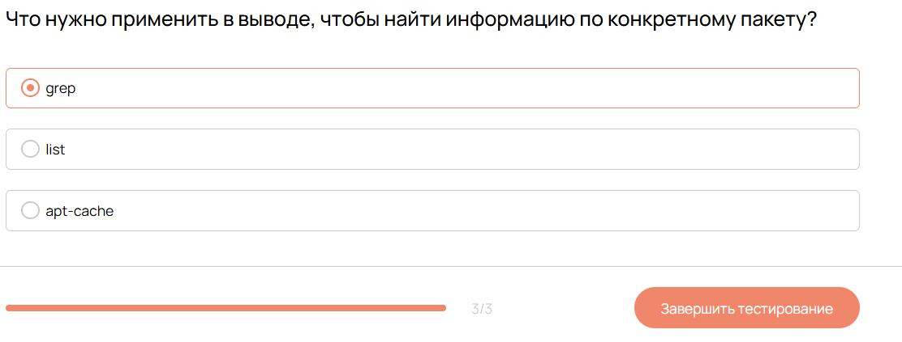

**Пояснение:** команда пытается исправить разорванные зависимости, устанавливая недостающие пакеты.

### Тест по теме «Работа с зависимостями и решение конфликтов»

**Вопрос 1. Какую команду нужно использовать, чтобы система попробовала установить недостающие зависимости?**
Правильный ответ: `--fix-broken install`.

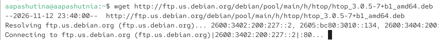

**Вопрос 2. Что случится, если вы удалите какой-то пакет, от которого зависимы другие пакеты?**
Правильный ответ: Разрыв зависимостей.

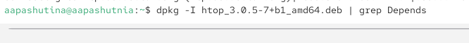

**Вопрос 3. Что нужно применить в выводе, чтобы найти информацию по конкретному пакету?**
Правильный ответ: grep.

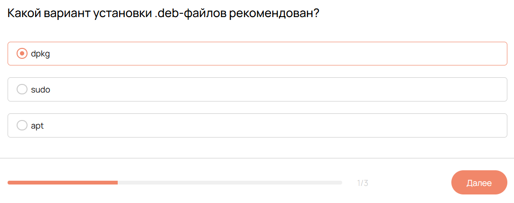

---

### Задания по теме «Работа с локальными .deb-пакетами и сторонними источниками»

**Задание №1. Установка пакета вручную через dpkg**

wget http://ftp.us.debian.org/debian/pool/main/h/htop/htop_3.0.5-7+b1_amd64.deb
sudo dpkg -i htop_3.0.5-7+b1_amd64.deb

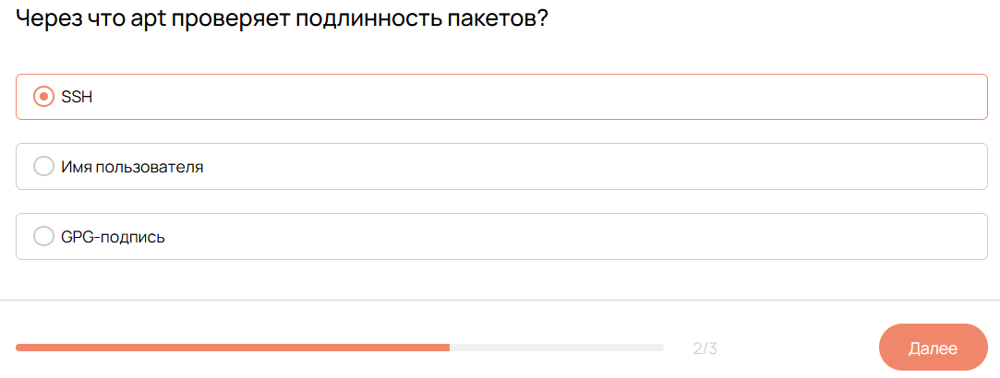

**Пояснение:** команда `dpkg -i` устанавливает локальный `.deb`-пакет.

**Задание №2. Анализ зависимостей пакета**

dpkg -I htop_3.0.5-7+b1_amd64.deb | grep Depends

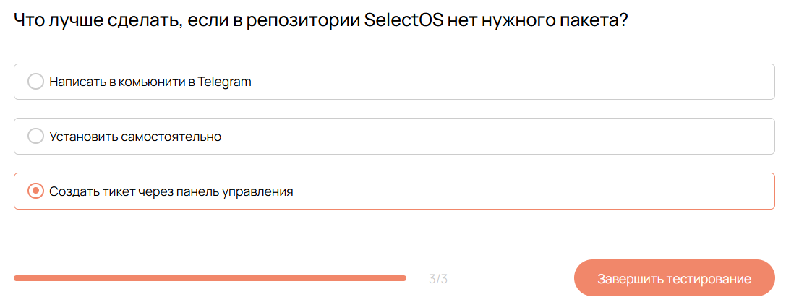

**Пояснение:** команда `dpkg -I` показывает информацию о пакете.

### Тест по теме «Работа с локальными .deb-пакетами и сторонними источниками»

**Вопрос 1. Какой вариант установки .deb-файлов рекомендован?**
Правильный ответ: apt.

**Вопрос 2. Через что apt проверяет подлинность пакетов?**
Правильный ответ: GPG-подпись.

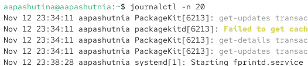

**Вопрос 3. Что лучше сделать, если в репозитории SelectOS нет нужного пакета?**
Правильный ответ: Создать тикет через панель управления.

---

## Модуль 10: Управление логами

### Задания по теме «Знакомство с логами»

**Задание №1. Просмотр основного системного журнала и журнала аутентификации**

less /var/log/syslog

**Пояснение:** команда `less` открывает файл в режиме постраничного просмотра.

**Задание №2. Вывод последних 20 записей из бинарного системного журнала**

journalctl -n 20

**Пояснение:** команда выводит последние 20 записей из системного журнала.

**Задание №3. Проверка наличия и расположения файла журнала ошибок Nginx**

ls -l /var/log/nginx/error.log

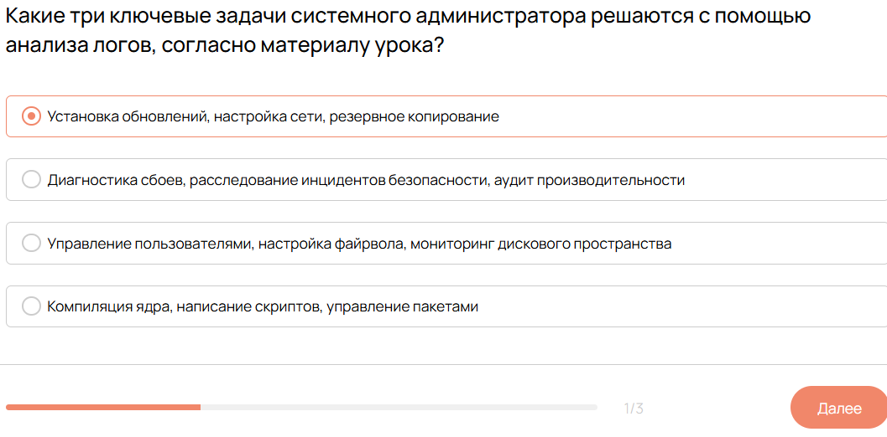

**Пояснение:** команда выводит информацию о файле, если он существует.

**Задание №4. Анализ строки из файла /var/log/auth.log**

Jun 26 14:32:10 server sshd: Accepted password for user from 192.168.1.15 port 12345 ssh2

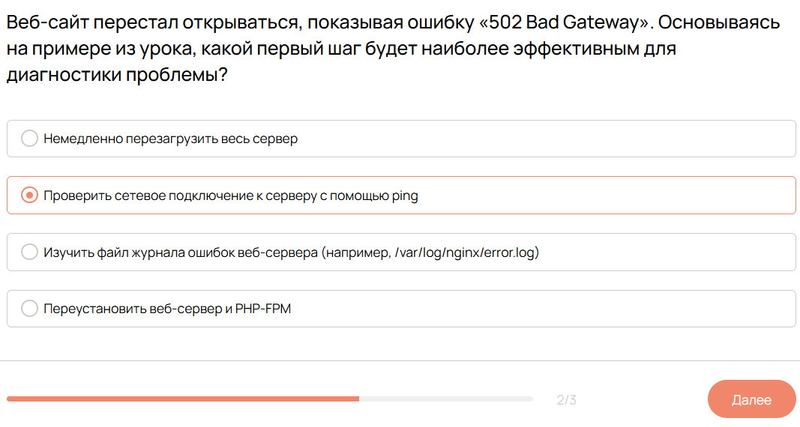

**Пояснение:** временная метка — `Jun 26 14:32:10`, сервис — `sshd`, событие — успешный вход.

**Задание №5. Фильтрация записей по службе cron**

journalctl -u cron.service

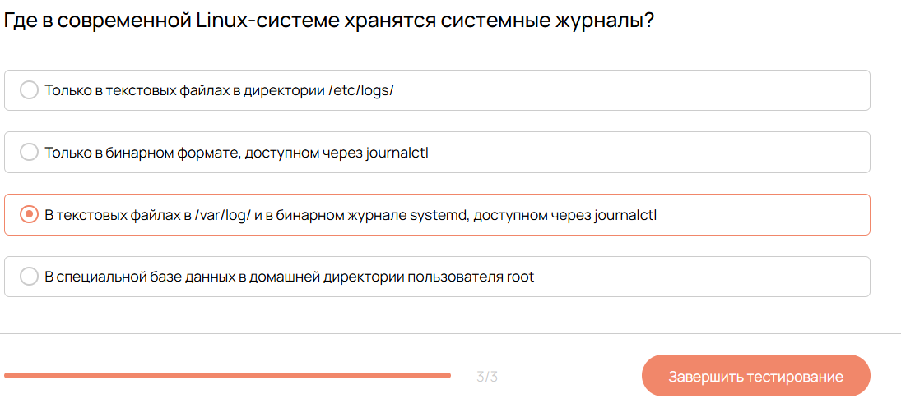

**Пояснение:** флаг `-u` ограничивает вывод журнала только записями службы cron.

### Тест по теме «Знакомство с логами»

**Вопрос 1. Какие три ключевые задачи системного администратора решаются с помощью анализа логов?**
Правильный ответ: Диагностика сбоев, расследование инцидентов безопасности, аудит производительности.

**Вопрос 2. Какой первый шаг для диагностики ошибки «502 Bad Gateway»?**
Правильный ответ: Изучить файл журнала ошибок веб-сервера.

**Вопрос 3. Где в современной Linux-системе хранятся системные журналы?**
Правильный ответ: В текстовых файлах в /var/log/ и в бинарном журнале systemd.

---

### Задания по теме «Система логирования в Linux»

**Задание №1. Проверка статуса служб rsyslog и systemd-journald**

systemctl status rsyslog.service

**Пояснение:** команда показывает текущее состояние службы rsyslog.

**Задание №2. Генерация тестового сообщения через logger**

logger "Это мое тестовое сообщение для проверки двойного логирования"

**Пояснение:** утилита `logger` отправляет сообщение в системный журнал.

**Задание №3. Фильтрация событий по уровню важности error**

journalctl -p err

**Пояснение:** флаг `-p err` фильтрует журнал по уровню важности.

**Задание №4. Поиск строки в конфигурации rsyslog**

grep 'auth.log' /etc/rsyslog.d/50-default.conf

**Пояснение:** команда ищет в конфигурационном файле строки, содержащие `auth.log`.

**Задание №5. Отправка сообщения с уровнем warning**

logger -p user.warn "Это специальное тестовое предупреждение"

**Пояснение:** флаг `-p user.warn` указывает категорию и уровень важности.

### Тест по теме «Система логирования в Linux»

**Вопрос 1. Каково типичное взаимодействие между systemd-journald и rsyslog?**
Правильный ответ: systemd-journald собирает все сообщения и перенаправляет их в rsyslog.

**Вопрос 2. Какой уровень важности будет присвоен событию «служба не смогла запуститься»?**
Правильный ответ: error.

**Вопрос 3. Каково назначение «категории» (facility) в syslog?**
Правильный ответ: Указывать на источник сообщения для маршрутизации.

---

### Задания по теме «Поиск и фильтрация логов под конкретные задачи»

**Задание №1. Поиск неудачных попыток входа по паролю**

grep -i "Failed password" /var/log/auth.log

**Пояснение:** флаг `-i` делает поиск регистронезависимым.

**Задание №2. Извлечение IP-адресов из успешных SSH-подключений**

grep "Accepted password" /var/log/auth.log | awk '{print $11}'

**Пояснение:** `awk` извлекает 11-е поле — IP-адрес клиента.

**Задание №3. Список уникальных IP-адресов с неудачными попытками входа**

grep "Failed password" /var/log/auth.log | awk '{print $11}' | sort | uniq

**Пояснение:** `sort` сортирует, а `uniq` удаляет дубликаты.

**Задание №4. Топ-5 IP-адресов по количеству успешных входов**

grep "Accepted password" /var/log/auth.log | awk '{print $11}' | sort | uniq -c | sort -nr | head -n 5

**Пояснение:** конвейер подсчитывает количество вхождений и выводит топ-5.

**Задание №5. Просмотр журналов за последние 15 минут**

journalctl --since "15 min ago"

**Пояснение:** флаг `--since` ограничивает вывод журнала записями за последние 15 минут.

### Тест по теме «Поиск и фильтрация логов под конкретные задачи»

**Вопрос 1. Какой конвейер команд правильно подсчитает количество вхождений каждого уникального IP-адреса?**
Правильный ответ: `sort ip_list.txt | uniq -c`.

**Вопрос 2. Что означает конструкция $3 в команде awk '{print $3}'?**
Правильный ответ: Вывести третье поле (столбец) каждой строки.

**Вопрос 3. Какая команда исключит строки, где упоминается healthcheck?**
Правильный ответ: `grep "error" /var/log/syslog | grep -v "healthcheck"`.

---

### Задания по теме «Расследование инцидентов по логам»

**Задание №1. Поиск попыток входа от несуществующих пользователей**

grep "Invalid user" /var/log/auth.log

**Пояснение:** команда находит строки с сообщениями о попытках входа от несуществующих пользователей.

**Задание №2. Определение IP-адреса с наибольшим количеством неудачных попыток**

grep "Failed password" /var/log/auth.log | awk '{print $11}' | sort | uniq -c | sort -nr | head -n 1

**Пояснение:** конвейер выводит IP-адрес с максимальным количеством неудач.

**Задание №3. Сохранение всех записей по подозрительному IP в отдельный файл**

grep "1.2.3.4" /var/log/auth.log > incident_report.log

**Пояснение:** команда сохраняет все строки с указанным IP в отдельный файл.

**Задание №4. Расчёт контрольной суммы SHA256 для файла**

sha256sum incident_report.log

**Пояснение:** команда вычисляет хеш SHA256 для файла.

**Задание №5. Проверка команд, выполненных через sudo текущим пользователем**

grep "sudo:" /var/log/auth.log | grep "USER=$(whoami)"

**Пояснение:** команда ищет записи о командах sudo, выполненных текущим пользователем.

### Тест по теме «Расследование инцидентов по логам»

**Вопрос 1. Какой тип активности означает сотни попыток входа с одного IP-адреса?**
Правильный ответ: Автоматизированная атака по подбору пароля (brute-force).

**Вопрос 2. Какой шаг критически важен для обеспечения целостности доказательств?**
Правильный ответ: Рассчитать и сохранить криптографическую контрольную сумму (хеш).

**Вопрос 3. Какой шаблон в логах релевантен для поиска команд с повышенными привилегиями?**
Правильный ответ: Поиск записей, содержащих sudo:.

---

### Задания по теме «Управление жизненным циклом логов и ротация»

**Задание №1. Изучение существующей конфигурации logrotate для apt**

cat /etc/logrotate.d/apt

**Пояснение:** команда выводит содержимое файла конфигурации logrotate.

**Задание №2. Создание собственного конфигурационного файла для testapp**

sudo touch /var/log/testapp.log
sudo nano /etc/logrotate.d/testapp

**Пояснение:** создаём файл и прописываем параметры ротации.

**Задание №3. Проверка конфигурации logrotate в режиме отладки**

logrotate -d /etc/logrotate.d/testapp

**Пояснение:** флаг `-d` показывает, что logrotate сделал бы, но не выполняет действий.

**Задание №4. Принудительный запуск ротации и проверка результата**

sudo logrotate -f /etc/logrotate.d/testapp

**Пояснение:** флаг `-f` принудительно запускает ротацию.

**Задание №5. Строка конфигурации rsyslog для пересылки логов на удалённый сервер**

*.* @@logs.example.com:514

**Пояснение:** строка пересылает все сообщения на удалённый сервер по TCP.

### Тест по теме «Управление жизненным циклом логов и ротация»

**Вопрос 1. Какую основную и наиболее насущную проблему решает утилита logrotate?**
Правильный ответ: Предотвращение исчерпания свободного места на диске.

**Вопрос 2. Какое ключевое преимущество в области безопасности дает отправка логов на удаленный сервер?**
Правильный ответ: Злоумышленник не сможет скрыть свои следы, удалив локальные логи.

**Вопрос 3. Какая система лучше всего подходит для Kubernetes с фильтрацией по меткам?**
Правильный ответ: Grafana Loki.

---

## Модуль 11: Контейнеризация

### Задания по теме «Контейнеризация как подход»

**Задание №1. Установка Podman и проверка установки**

sudo apt update
sudo apt install podman

**Пояснение:** команда `apt install podman` устанавливает утилиту Podman.

**Задание №2. Запуск контейнера**

podman run -it --rm alpine sh

**Пояснение:** флаг `--rm` автоматически удаляет контейнер после выхода.

### Тест по теме «Контейнеризация как подход»

**Вопрос 1. Какая команда позволяет проверить конфигурацию Podman?**
Правильный ответ: `podman info`.

**Вопрос 2. Чем Podman отличается от Docker?**
Правильный ответ: Не требует фонового демона.

**Вопрос 3. Что делает ключ --rm в podman run?**
Правильный ответ: Удаляет контейнер после завершения.

**Вопрос 4. Почему Podman безопаснее для многопользовательских систем?**
Правильный ответ: Поддерживает запуск без root и демона.

**Вопрос 5. Какой компонент не нужен при работе с Podman?**
Правильный ответ: Системный демон.

---

### Задания по теме «Работа с контейнерами в Podman»

**Задание №1. Запуск Nginx и проверка его работы**

podman run -d --name my-nginx -p 8080:80 docker.io/library/nginx

**Пояснение:** флаг `-p 8080:80` пробрасывает порт 8080 на хосте на порт 80 внутри контейнера.

**Задание №2. Развёртывание сайта в Nginx с использованием локальной папки**

mkdir -p /home/user/site
echo "<h1>Hello from Podman</h1>" > /home/user/site/index.html
podman run -d --name my-nginx -p 8080:80 -v /home/user/site:/usr/share/nginx/html:ro docker.io/library/nginx

**Пояснение:** флаг `-v` монтирует локальную директорию в контейнер.

### Тест по теме «Работа с контейнерами в Podman»

**Вопрос 1. Какая команда запускает контейнер с пробросом порта 8080 на 80?**
Правильный ответ: `podman run -p 8080:80 nginx`.

**Вопрос 2. Что делает флаг -v при запуске контейнера?**
Правильный ответ: Монтирует директорию с хоста внутрь контейнера.

**Вопрос 3. Что произойдет при использовании флага -it?**
Правильный ответ: Откроется shell внутри контейнера.

**Вопрос 4. Как просмотреть все (включая остановленные) контейнеры?**
Правильный ответ: `podman ps -a`.

**Вопрос 5. Что делает флаг --rm при запуске контейнера?**
Правильный ответ: Автоматически удаляет контейнер после завершения.

---

### Задания по теме «Управление ресурсами контейнеров»

**Задание №1. Запуск контейнера Nginx с ограничением памяти**

podman run -d --memory=100m --name nginx-limited nginx

**Пояснение:** флаг `--memory=100m` ограничивает потребление памяти до 100 МБ.

**Задание №2. Исследование поведения контейнера при исчерпании памяти**

podman run --memory=100m --name stress-test docker.io/progrium/stress --vm 1 --vm-bytes 150m --vm-hang 0

**Пояснение:** утилита пытается выделить 150 МБ, но лимит — 100 МБ, поэтому процесс будет убит (OOM).

### Тест по теме «Управление ресурсами контейнеров»

**Вопрос 1. Какая команда позволяет отслеживать использование ресурсов контейнера в реальном времени?**
Правильный ответ: `podman stats`.

**Вопрос 2. Что делает флаг -d при запуске контейнера?**
Правильный ответ: Запускает контейнер в фоновом режиме.

**Вопрос 3. Что делает команда systemctl daemon-reload?**
Правильный ответ: Перечитывает unit-файлы.

**Вопрос 4. Как просмотреть логи контейнера?**
Правильный ответ: `journalctl -u имя.service`.

**Вопрос 5. Что делает флаг --memory=512m при запуске контейнера?**
Правильный ответ: Устанавливает жесткое ограничение оперативной памяти для контейнера.

---

## Финальный тест

**Результат тестирования:** 17 из 17 (тест пройден).

**Вопрос 1. Какие права доступа соответствуют числовому значению 754?**
Правильный ответ: `rwxr-xr--`.

**Вопрос 2. Что произойдет, если вы используете команду sudo для выполнения действий?**
Правильный ответ: Будет зафиксировано, кто и когда выполнил команду.

**Вопрос 3. Где хранятся основные лог-файлы в Linux?**
Правильный ответ: `/var/log/`.

**Вопрос 4. Какая команда выводит наиболее полную справочную информацию?**
Правильный ответ: `man`.

**Вопрос 5. Что делает команда dig?**
Правильный ответ: Выполняет DNS-запрос и отображает IP-адреса.

**Вопрос 6. Какую роль выполняет /opt в структуре файловой системы?**
Правильный ответ: Дополнительное ПО, которое не входит в стандартные репозитории.

**Вопрос 7. Какую команду нужно использовать для установки новых версий пакетов?**
Правильный ответ: `upgrade`.

**Вопрос 8. Какая из задач относится к ключевым обязанностям системного администратора?**
Правильный ответ: Мониторинг состояния серверов.

**Вопрос 9. Какую команду нужно выполнять регулярно?**
Правильный ответ: `apt update`.

**Вопрос 10. Как добавить комментарий в скрипт?**
Правильный ответ: Использовать `#`.

**Вопрос 11. Какая команда позволяет просматривать данные из каталогов /proc или /dev, используя принципы работы с файлами?**
Правильный ответ: `cat`.

**Вопрос 12. Какую команду надо ввести, чтобы посмотреть, какие права выданы файлам?**
Правильный ответ: `ls -l`.

**Вопрос 13. С помощью каких операторов можно указать тип изменения прав?**
Правильный ответ: `+ - =`.

**Вопрос 14. Что делает команда info?**
Правильный ответ: Открывает справку в формате info для заданной команды.

**Вопрос 15. Какая из задач относится к ключевым обязанностям системного администратора?**
Правильный ответ: Мониторинг состояния серверов.

---

## Итоги

В ходе прохождения Части 3 внешнего курса «Системный администратор Linux с нуля» были освоены:

- настройка сетевых интерфейсов, диагностика сети и защита SSH-доступа;
- управление пакетами (установка, обновление, удаление, работа с зависимостями);
- работа с логами (просмотр, фильтрация, анализ инцидентов, ротация);
- контейнеризация с помощью Podman (запуск контейнеров, управление ресурсами);
- обеспечение безопасности сетевого взаимодействия (UFW, fail2ban).

Все тесты и интерактивные задания Части 3 пройдены. Цель работы достигнута.